# Session 2 report: the pharmacy flow and the live signal

Status: **done checks pass**, with two parts verified on a local production build because two Vercel variables are not set yet (section 6). The core loop works end to end on https://rupturewatch-tn.vercel.app: a pharmacist reports in two taps, the level changes, the pharmacies and coordinators concerned are alerted, and the reporter sees what the report changed.

## 1. Done checks

All runs were driven in headless Chrome with a 360 × 780 mobile viewport (Chrome device emulation, desktop user agent), each person in a separate browser profile. No physical phone was used. Demo pharmacies and the coordinator used the deployed site; the two testers used a local production build (`next build && next start`) connected to the same live database, because `TESTER_INVITE_CODE` is not yet set on Vercel and the deployed invite link answers 404. Final run on commit `1001d4d`.

| # | Check | Result | How it was verified |
| --- | --- | --- | --- |
| 1 | As "Pharmacie (Tunis)", report levetiracetam in two taps from the home of the space; the result shows the level, the explanation and the impact | **Pass** (deployed) | From `/pharmacie`: tap 1 on the LEVETIRACETAM row (opens its page with the four "when" buttons), tap 2 on "Il y a 3 jours". Result screen in 1.7 s: "Avant: Aucun signal, Après: Sous surveillance", "Moins de 3 pharmacie(s) signale(nt) une commande non livrée depuis plus de 72 heures…", "Avec votre signalement, moins de 3 pharmacies signalent ce médicament sur les 14 derniers jours", guidance, disclaimer, review status. Screenshots 02 and 03. |
| 2 | "Moins de 3 jours" sends nothing and shows the "too early" message | **Pass** (deployed) | Picker, CARBAMAZEPINE, "Moins de 3 jours": the page stays, "Pas encore un signal" and the team's text appear; reports for carbamazepine in the database before and after: 0 and 0. Screenshot 05. |
| 3 | Four pharmacies in two governorates (2 demo + 2 testers via `/rejoindre`) reach "Confirmée"; `signal_events` holds none, watch, likely, confirmed; both demo pharmacies see the alert with the disclaimer | **Pass** (demo pharmacies deployed, testers local) | Tunis (TN-11) "Il y a 3 jours", Sfax (TN-61) "4 à 7 jours", tester in Sousse (TN-51) "Plus d'une semaine", tester in Kairouan (TN-41) "Il y a 3 jours", testers finding the medicine by typing "levetiracetam" (the molecule comes first). `signal_events`: none→watch (`local_reports_below_threshold`), watch→likely (`two_pharmacies_7d`), likely→confirmed (`confirmed_threshold`), nothing else. Both demo pharmacies: "Alertes 3", each alert with "Ceci n'est pas une déclaration officielle de rupture." and the review status. Screenshot 10. |
| 4 | "Livré à nouveau" from two pharmacies, then the cron route run with a `now` 15 days later in a test, gives "Levée" and a stand-down alert | **Pass** (tests); partly shown live | `tests/db/pharmacy-flow.test.ts` (real SQL) and `tests/signal-service.test.ts`: confirmed, two `delivered_again`, `recomputeAll` at +15 days → `confirmed > cleared`, rule `delivered_again_cleared`, 5 stand-down alerts. Live: both demo pharmacies tapped "Livré à nouveau" (button shown only to pharmacies that reported); the level correctly held at "Confirmée" (`deliveredAgainPharmacies: 2`, quiet period not over); the cron route with the secret on the local build answered `{checked: 1, changed: 0, failed: 0}`. The deployed cron answers 401 until `CRON_SECRET` is set on Vercel. |
| 5 | A tester's reports carry "Testeur", a demo pharmacy's carry "Simulé" | **Pass** | On the molecule page, "Mes signalements": testers' rows show TESTEUR (local), demo pharmacies' rows show SIMULÉ (deployed). The database refuses a demo pharmacy filing a tester report and the reverse (new insert policy, tested). Screenshots 08 and 11. |
| 6 | No response sent to a pharmacy contains another organisation's id or name | **Pass** | `tests/db/pharmacy-flow.test.ts` reads, as a pharmacy, every table it may select plus `report_impact`, and finds no other organisation's id or name; `report_impact` returns exactly two columns (`pharmacies`, `governorates`). On the deployed site, the full HTML (including the React payload) of the result, alerts and molecule pages of both demo pharmacies contained none of the other demo organisations' ids or names, nor "Pharmacie testeuse". |
| 7 | Concurrency test passes; all earlier tests pass; `lib/signal` unchanged | **Pass** | 236 tests in 15 files pass (lint and type check clean). Concurrency: two simultaneous reports produce one event; a stale evaluation is refused and re-evaluated, never overwriting a newer level or skipping its event. `git diff 9aab0f3 HEAD -- lib/signal tests/signal.test.ts` is empty. |

Also verified on the deployed site: the coordinator preview showed each tester's report 2.2 s and 2.4 s after the tap, without reloading (it either received the Realtime event or polled; the run did not tell which).

**Verification data was removed afterwards.** The runs created real rows in the live project (demo reports marked simulated, and tester pharmacies that were not real pharmacists). `npm run verify:clean -- --since <start> --apply` removed them: tester pharmacies, their accounts and reports, the demo pharmacies' reports, and levetiracetam's alerts, event log and signal through `reset_molecule_signal()`. The live project now holds no report, signal, event, alert or tester; the 22 seeded follows remain. Real testers start from an empty state on Monday.

## 2. What was built

**Signal service** (`lib/signals/`): `recomputeSignal(store, moleculeId, now)` loads 120 days of reports and notices, calls `evaluate()`, and stores the result through `apply_signal_evaluation()` (compare-and-set on level and `updated_at`; signal row, event and alerts in one transaction; reload and retry on conflict). Evidence is stored as counts and public notice data only. Data access is injected: an in-memory store for unit tests, a PGlite store for the real SQL, a Supabase store in production. `recomputeAll()` and the daily cron `/api/cron/recompute` (04:30 UTC, `vercel.json`, `Authorization: Bearer <CRON_SECRET>`).

**Pharmacy space** (`/pharmacie`):
- Home: primary button "Signaler une commande non livrée", tabs "Mes médicaments suivis" and "Alertes" with the unread count, followed molecules with level and since date (most serious first), "Suivre un médicament" search, honest empty state.
- `/pharmacie/signaler`: tap one, followed molecules as large rows, then search. `/pharmacie/signaler/[id]`: tap two, the four delays.
- `/pharmacie/molecule/[id]`: level, since, explanation, the four delays, "Livré à nouveau" when allowed, guidance, active foreign notices with links and origin badges, own reports (date, kind, channel, origin), follow or unfollow.
- `/pharmacie/molecule/[id]/resultat`: level before and after, explanation, impact, guidance, disclaimer, review status.
- `/pharmacie/alertes`: each alert with molecule, from and to level, time, explanation, guidance or the stand-down message, disclaimer, review status, "Marquer comme lue", "Tout marquer comme lu"; live.

**Tester onboarding**: `/rejoindre/[code]` (governorate only), `/coordination/invitation` (QR code, coordinators only).

**Coordinator preview** (`/coordination`): molecules with a signal, level, since, explanation and rule; live.

**Search**: `search_molecules(q)`; the catalogue search returns molecules first, then medicines. "levetiracetam", "lévétiracétam", "levetiracetan" and "levetir" now lead to the molecule LEVETIRACETAM (15 presentations) first; brand names such as "epitam" still lead to the brand.

**Components**: `LevelExplanation` (reusable by every role), `Guidance`, `ReportTimingForm`, `MoleculeSearch`, `PharmacyHeader`, `LiveRefresh`.

**Database** (migrations 0008 and 0009, applied live, schema version 9): `report_impact`, `apply_signal_evaluation`, `create_tester_pharmacy` with a numbering sequence, `search_molecules`, `reset_molecule_signal`, `app.current_organisation_origin`, the tightened reports insert policy (origin must be the organisation's own), alerts read marking (`read_at` only), Realtime publication of `signals` and `alerts`.

**Content**: `docs/content/guidance.fr.json` and `rules.fr.json` merged word for word into `messages/fr.json` under `guidance` and `rules`; `tests/content.test.ts` checks both copies and that every `RuleId` has a sentence (the rule list is type-checked against `RuleId`).

**Seeds and scripts**: `supabase/seed/demo-follows.json` (11 molecules for the two demo pharmacies, exact catalogue names, applied live), `npm run verify:clean`.

**Fixes found by the deployed checks**:
- `report_impact` compared the report's time (stamped by the app server) with the database's clock; a server clock 1.5 s ahead hid the newest report. The server now passes its own time; re-verified ("5 pharmacies dans 5 gouvernorats" including the new report).
- Explanation sentences starting with a count read "moins de 3 …"; they are now capitalised.
- Functions now run in Dublin (`dub1`), next to the database in `eu-west-1`: a report went from 4.2 s to 1.7 s.
- Migration 0008 first failed on Supabase (a `pg_trgm` setting on a function, unknown in a fresh session); it now loads the module first. The failed attempt was rolled back by the CLI.

## 3. Decisions

All in `docs/DECISIONS.md` under session 2: compare-and-set storage and the cron; no alert when "levée" fades to none; tester accounts created by the server rather than anonymous sign-ins; no role switch for testers; `qrcode` dependency; the two-tap path; auto-follow on report; `report_impact` withholding the governorate count below 3 pharmacies; "moins de 3" for pharmacy counts only; Realtime with polling fallback.

## 4. Open questions

1. **Valproate.** The catalogue has no molecule "VALPROATE DE SODIUM". Depakine and Valoxine are listed under ACIDE VALPROIQUE; the only molecule containing "valproate de sodium" is "VALPROATE DE SODIUM + ACIDE VALPROIQUE" (Valproate de sodium Mylan, Tripakine LP). The seed follows the latter only, as the brief named it. Should the demo pharmacies also follow ACIDE VALPROIQUE?
2. **Exact counts in `signals.evidence`.** Signed-in users can read `signals` and `signal_events` through the API, so the exact numbers behind "moins de 3" (1 or 2) are readable by anyone with a session, though never shown on screen and never with an identity or a governorate. Should evidence be stored already suppressed, or `signals` be served through a function? (Matters before session 4 opens it to more roles.)
3. **Impact wording.** `report_impact` counts the reporter. The screen says "Votre signalement s'ajoute à 4 pharmacies…" meaning 4 including you. Should it count the others only?
4. **Tester numbering.** The verification runs used numbers 1 to 6; the first real tester will be "Pharmacie testeuse n° 7". Restarting the sequence needs a migration; say if you want it.
5. **Realtime or polling.** Updates arrived within 2.4 s, but the run did not distinguish Realtime from the fallback poll. Session 4 can log which one served.

## 5. Not done

Nothing from the brief is left out. The deployed parts that depend on the two missing Vercel variables (tester invite link, cron) were verified on the local production build with the same database.

## 6. Manual steps for the team lead

1. **Vercel → Settings → Environment Variables (Production)**: add `TESTER_INVITE_CODE` and `CRON_SECRET` with the values printed at the start of this session (also in `.env.local`), then redeploy. Without them, `/rejoindre/...` answers 404, `/coordination/invitation` says the code is not configured, and the daily cron is refused (401).
2. After the redeploy: Vercel → Settings → Cron Jobs should list `/api/cron/recompute` at 04:30 UTC; "Run" it once and check it answers 200.
3. **Anonymous sign-ins: not needed.** Testers' accounts are created by the server (see DECISIONS).
4. **Supabase → Authentication → Rate Limits**: raise "sign-ups and sign-ins" (from session 1, still needed: demo role sign-ins and tester sign-ins come from the server's IP).
5. From session 1, if not done: the CI result in the Actions tab, and the `HEALTH_URL` variable plus one manual keep-alive run.
6. Before Monday: open `/coordination/invitation` as Coordination on a phone to show the QR code to testers. Testers should keep the same browser for the whole test (their account lives in it).

## 7. Screenshots

All at 360 px except the coordinator (1280 px). Files in `docs/reports/session-2/`.

The report flow: home, tap one (picker), tap two (the four delays), too early.

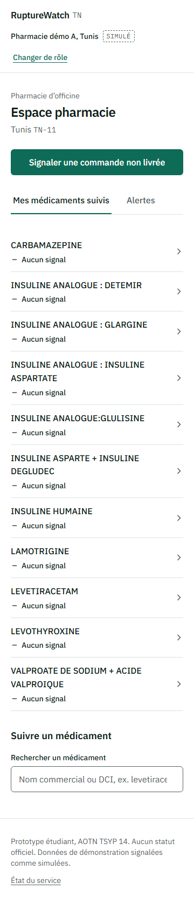
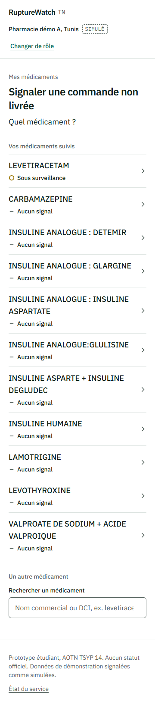
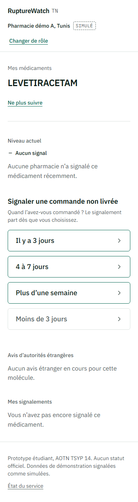
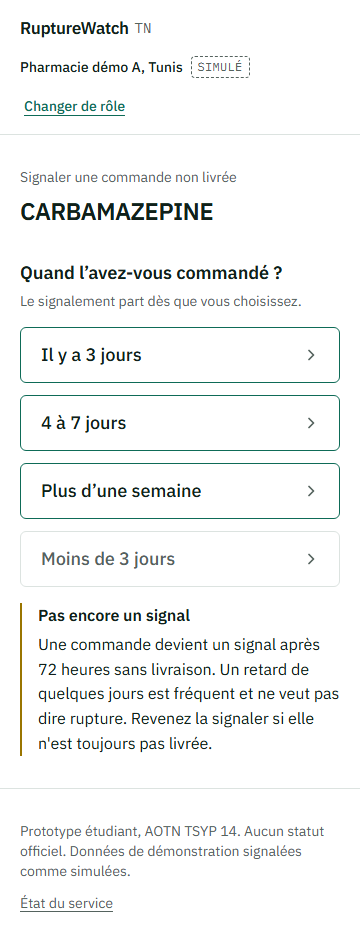

The result screen:

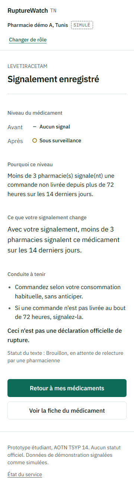

An alert (three alerts for levetiracetam, newest first):

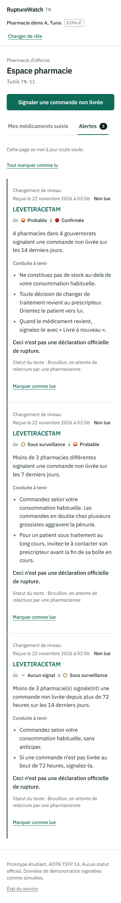

Testers and the coordinator:

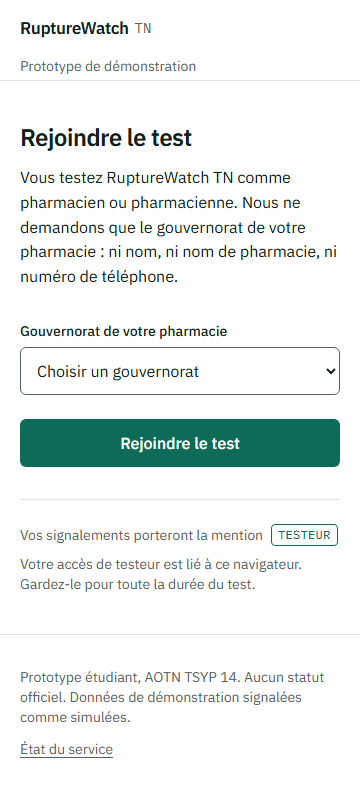
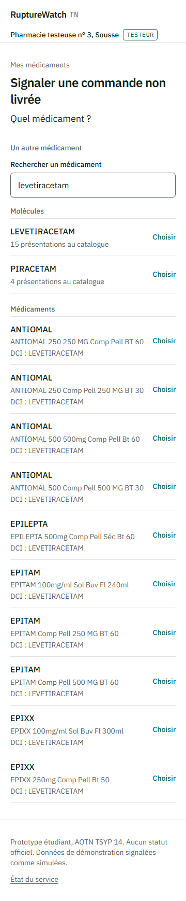
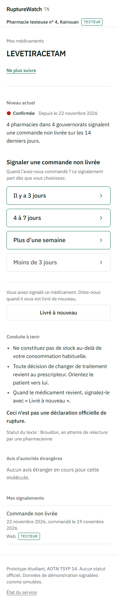
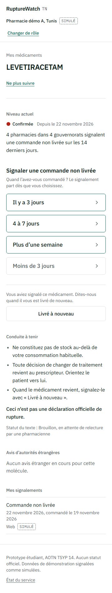
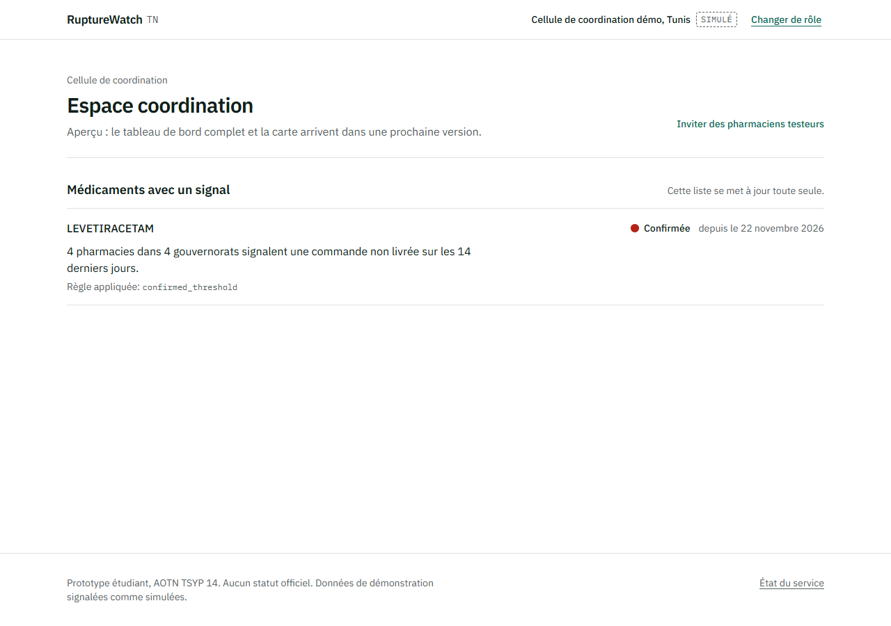

The invitation page with its QR code was checked but is not included: the QR code and the link contain the invite code.
