# Session 4 report: the coordination space and the showcase

Status: **all five done checks pass on the deployed site** (https://rupturewatch-tn.vercel.app, checks run on commits `d3d0235` and `79e37a7`; the last commit, `c525d85`, adds origin badges to the pharmacy pages and was checked there too; schema version 13). The two data files the team supplies (`episodes.csv`, `foreign_notices.csv`) have not arrived: `/retour` shows its empty state and the import script is ready for them.

**Interruptions.** The session stopped once when the computer shut down. On resuming, the working tree, the commits and the live migrations were checked: nothing was lost or half-applied. One mistake: the code that reads signals through `signals_view` and `my_alerts` (fix 2) was pushed before migrations 0011 and 0012 were applied to the live database, because applying them needed your approval. Until they were applied, pages calling those functions failed on the deployed site. Since then every migration is applied before the code that needs it is pushed.

## 1. Done checks

| # | Check | Result | How it was verified |
| --- | --- | --- | --- |
| 1 | As Coordination, after two demo reports, the map and the list update without reload, counts under 3 show "<3", the demand panel shows | **Pass** (deployed) | Headless Chrome, signed in as Coordination on `/coordination` (Realtime mode). In other windows, Pharmacie (Tunis) then Pharmacie (Sfax) reported ACIDE VALPROIQUE through the real report form. The coordination page showed "Sous surveillance" 1.9 s after the first report and "Probable" 1.7 s after the second. A marker set in the page before the reports was still there after them, so the page was never reloaded. The map and table show Tunis `<3` and Sfax `<3`. The demand panel shows, with its line that requests never change the level. No pharmacy name appears on the page. Run twice, same result. Screenshots 07, 08. |
| 2 | `/vues/[moleculeId]` shows four panels; a test proves each panel's data came through its role's own access path; no pharmacy name in any panel but the pharmacy's own | **Pass** (deployed) | On the deployed page, after the two reports: the pharmacy panel names only "Pharmacie démo A, Tunis", its own account; the wholesaler, coordination and public panels contain no pharmacy name. Refusals, as measured with each role's own account: the pharmacy is refused counts by governorate and patient demand; the wholesaler and coordination get no rows from `reports`; the public is refused all five reads. Tests: `tests/four-views.test.ts` gives each panel a fake client that records its calls and returns data tagged with its role. Each panel holds only its own client's data, and each client receives exactly its own panel's reads. `tests/view-clients.test.ts`: the page signs each panel in as its own demo account and gives the public panel no session. `tests/live/four-views.test.ts` runs the same loader on the real project with the real accounts. That live test caught a bug the fakes could not (the organisation name column is `display_name`), fixed before the push. Screenshots 05, 06. |
| 3 | `/scenario` plays to "Levée" in under two minutes, restarts cleanly, no new rows | **Pass** (deployed) | It reached "Levée" in 21.8 s, ending on the stand-down message. "Recommencer" returned to step 0, "Aucun signal". The browser made no request between the page load and the end of the run. The row counts of `reports`, `signals`, `signal_events`, `alerts`, `availability_requests`, `foreign_notices` and `organisations` were identical before and after. Screenshots 03, 04. |
| 4 | `/retour` and `/methode` render; with `episodes.csv` absent, `/retour` shows the empty state | **Pass** (deployed) | `/retour`: 200, "Données en cours de constitution", at 360 and 1280 px. `/methode`: 200, with every threshold read from `lib/signal/params.ts`. `tests/episodes.test.ts` covers the file's format, rejected rows, leads, misses and the median for when it arrives. Screenshots 12 to 15. |
| 5 | The four fixes are in, with tests; all earlier tests pass; `lib/signal` unchanged | **Pass** | Fix 1: `tests/seed.test.ts`. Fix 2: `tests/db/signal-views.test.ts` and `tests/db/grants.test.ts`, on PGlite with the real migrations. Signed-in users have no select on the evidence columns; `signals_view`, `signal_events_view` and `my_alerts` return `<3`, and the number of governorates is withheld below 3. Fix 3: `tests/impact-text.test.ts`. Fix 4: `tests/db/signal-views.test.ts` (numbering restarts only when no tester remains). `npm run check`: lint, type check, 350 tests in 28 files pass; `npm run test:live`: 10 pass on the real project (1 skipped, as before). `lib/signal/` has not changed since it was added (`9aab0f3`). |

Verification data was removed afterwards with `npm run verify:clean -- --since … --apply` after each of the three runs (two full runs, then one report for the pharmacy screenshots). The live project now has no report, signal, event or alert, and keeps the 24 seeded follows of the demo pharmacies.

## 2. What was built

**Fixes** (migrations 0011, 0012, applied live). Signals reach the app only through functions that return counts under 3 as `<3`. The impact sentence reads "Avec la vôtre, N pharmacies…". The demo pharmacies follow ACIDE VALPROIQUE. Tester numbering restarts at 1, and `verify:clean` resets it.

**Origins and the public status** (migration 0013, applied live). Each signal records the origins of the data it counted, so every level shown carries its "Simulé", "Testeur" or "Source officielle" badge. That covers coordination, the hospital space, `/vues` and the pharmacy's own pages: the list, the report picker, the molecule page, the result and the alerts. The pharmacy pages were the last place where a level from simulated reports showed without its badge. `public_status()` is the public side's only read of a level: confirmed or not.

**Coordination space** (`/coordination`):
- The molecules with a level, most serious first.
- For the selected one: the governorate map with a legend and a table (`<3` below 3), the explanation with a link to the method, patient demand over 7 days with the line that it never changes the level, active foreign notices with links, and the timeline of its levels.
- The event log, newest first, with the rule that fired.
- Live updates (Realtime, polling every 4 s otherwise).

The hospital pharmacy space (`/hopital`) is the same without the export and the log.

**Export** (`/coordination/export`): CSV and JSON, aggregates only, coordinator only. The page explains each column, its meaning and where its value comes from.

**Methods page** (`/methode`), public: levels, what counts as a report, the two gates, every rule by its identifier (each explanation links to its rule), thresholds from `params.ts`, what the platform never does, real and simulated data, and sources from `data/SOURCES.md`.

**Scenario** (`/scenario`), public: a fictional shortage played by `buildScenario()` and `evaluate()` in the browser. Controls: Lancer, Pause, Étape suivante, Recommencer. Each step shows the level and its explanation, the map counts, who is alerted, the history of changes, and "Simulé" on each part. It writes nothing anywhere.

**Time machine** (`/retour`), public: built against the `episodes.csv` format.
- A timeline per episode, with a source link for each date and misses stated plainly.
- At the top, the computed counts: episodes, episodes with an earlier foreign notice, and the median lead.
- A date slider showing the level `evaluate()` gives from the foreign notice alone, with the gate-one sentence.
- Empty state until the file exists.

**Notice import** (`npm run notices:import`): dry run by default, `--apply` to write.
- Rows are validated and matched to `molecules.name` exactly; rows that don't match are listed.
- Loaded rows get `origin = official_source`; notices already loaded are skipped.
- The affected molecules are then recomputed through `evaluate()`.

It was tried on a temporary file against the live catalogue: it matched LEVETIRACETAM, listed the misspelt "LEVETIRACETAME" and rejected a bad status. Nothing was written.

**Four views** (`/vues`, `/vues/[moleculeId]`), public: the pharmacy, wholesaler, coordination and public panels for one molecule, each loaded as its own role, each listing what the database refused it. The index lists molecules with a level (as Coordination sees them) and those the demo pharmacy follows.

**Home page**: "Voir une rupture simulée, du premier signe à la levée" is the first button. Under "Comment ça marche", a "Comprendre" list links the scenario, the four views, the method and the replay.

## 3. Decisions

In `docs/DECISIONS.md` under "2026-11-22, session 4": the four fixes, origins and `public_status`, the coordination and hospital spaces, the export format, the methods page, the scenario in the browser, the time machine's rules (lead, miss, median, notice status), the notice import, and how `/vues` loads each panel. No new dependency: the CSV reader is 40 lines in `lib/content/csv.ts`.

## 4. Open questions

1. **Demo data for the jury.** After cleaning, the live project has no signal, so `/coordination`, `/hopital` and `/vues` open on empty states. The scenario shows a full shortage without one. Should a simulated active signal be seeded for demo day (in a named seed file, marked `simulated`, rule 5), or should the jury see the real empty state?
2. **`/vues` shows professional views to anyone.** It shows nothing the one-click demo accounts don't, and it says so. For a ministry pilot, both would be removed. Confirm this is acceptable for the competition.
3. **The wholesaler panel** uses the reads the database grants a wholesaler, because track C's wholesaler screens don't exist yet. Track C should build on the same functions (`lib/signals/views.ts`) so the panel and the screen stay the same.
4. **Episodes without a notice status.** The time machine treats each episode's foreign notice as a shortage notice, since `episodes.csv` has no status column. If some episodes' notices were only "tension", add a column.
5. **Still open from shared foundations:** the Arabic texts need review by an Arabic speaker, and track B's pharmacy answer screen location needs confirming.
6. **Favicon:** every page requests `/favicon.ico` and gets a 404. It predates this session and is harmless, but it shows in the browser console.

## 5. Manual steps for the team lead

1. **When the data files arrive** (`data/reference/episodes.csv`, `data/reference/foreign_notices.csv`):
   - Commit `episodes.csv` and push. `/retour` is static, so the redeploy is what shows it.
   - For notices, run `npm run notices:import` (dry run) and fix every name it lists as not matched in the file. Then run `npm run notices:import -- --apply`. This writes to the live database and recomputes the affected molecules. A notice alone never raises a molecule above "sous surveillance".
   - Add both files to `data/SOURCES.md`: who compiled them, when, and from which sources.
2. **Vercel → Settings → Environment Variables → Preview:** `DEMO_ACCOUNT_PASSWORD` is needed there too. Without it, `/vues` on a preview shows "Les comptes de démonstration ne répondent pas pour le moment", which is the intended fallback.
3. **Supabase → Authentication → Rate Limits** (optional, before demo day): `/vues` signs in three demo accounts each time a server instance starts, on top of visitors' one-click sign-ins, all from Vercel's addresses. If "Trop de connexions de démonstration" appears during rehearsal, raise the sign-in limit there.
4. **Carried over from shared foundations:**
   - Teammates who branched before 20:26 on Sunday merge `main`.
   - The Google keys and map ID go on Vercel (the map fallback works meanwhile).
   - The Supabase variables and `DEVICE_HASH_SALT` go in Preview.

## 6. Screenshots

On the deployed site, at 360 and 1280 px. Files in `docs/reports/session-4/`. The coordination, hospital and four-view screenshots were taken right after the two demo reports of done check 1, before cleaning. Screenshots 16b to 19 were taken after one report by Pharmacie (Tunis), with the origin badges next to each level.

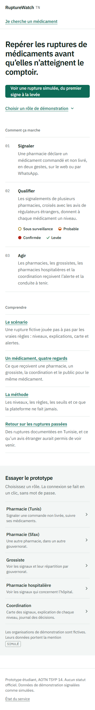
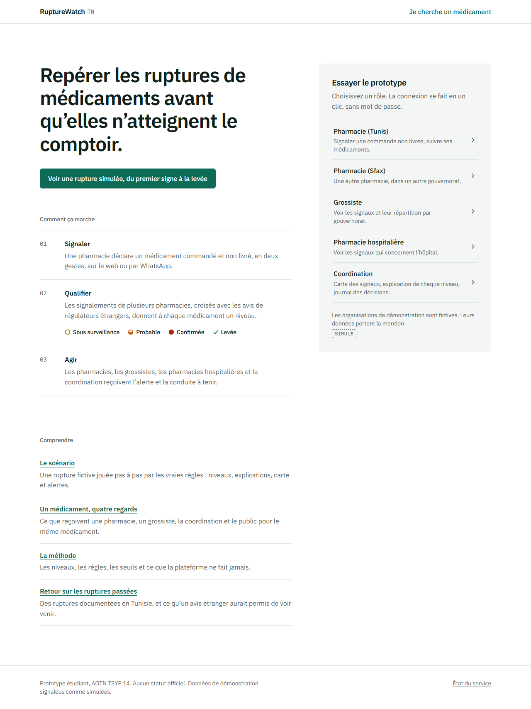
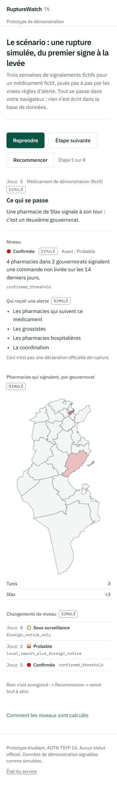
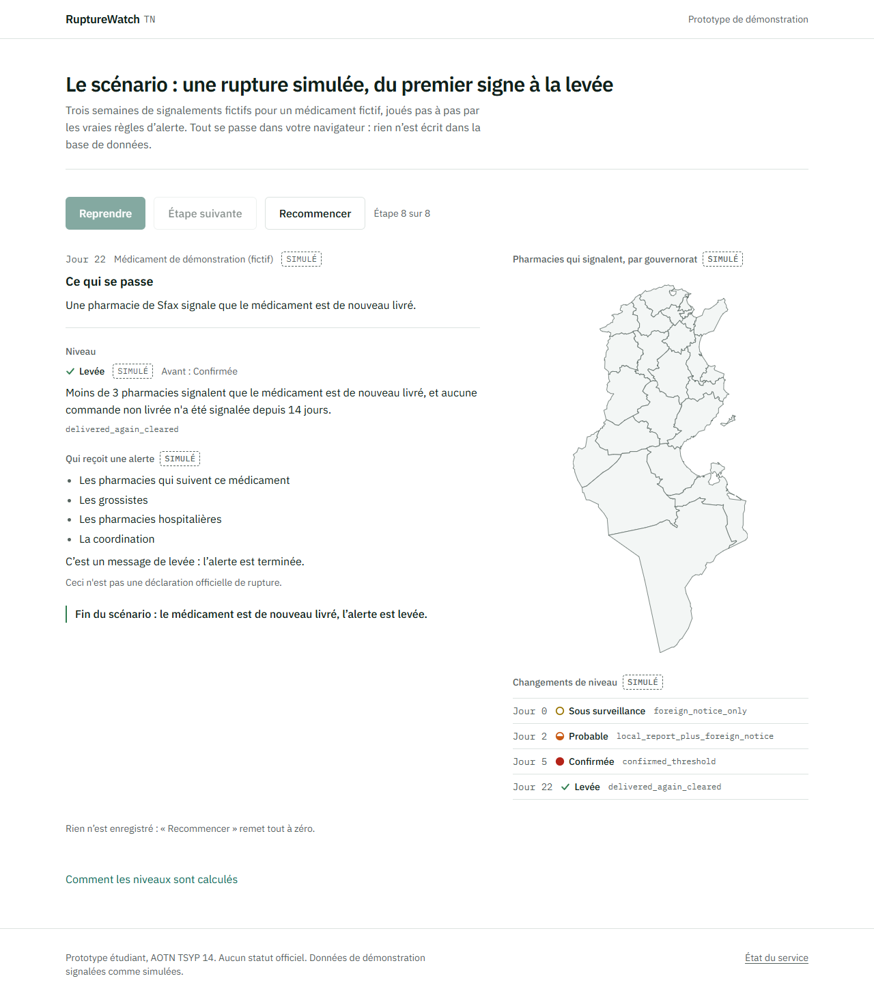
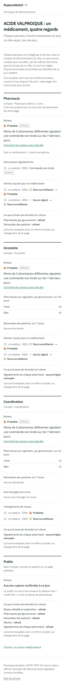
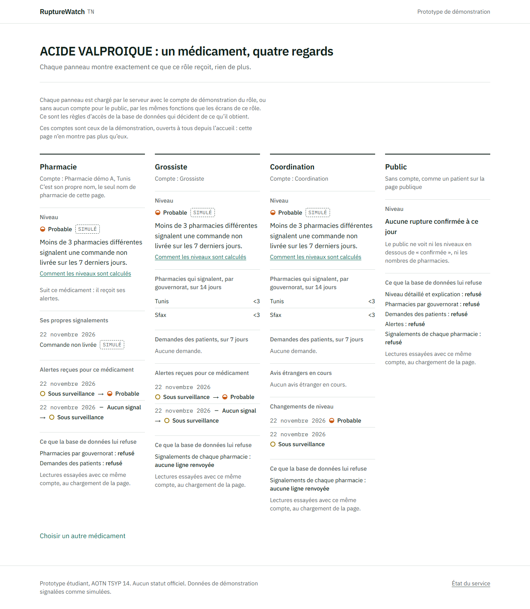
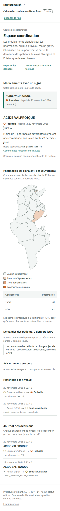
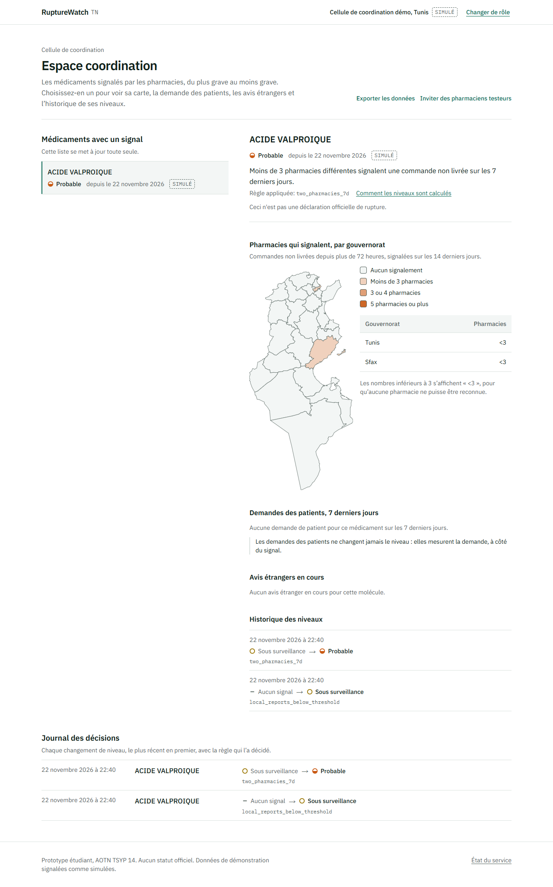
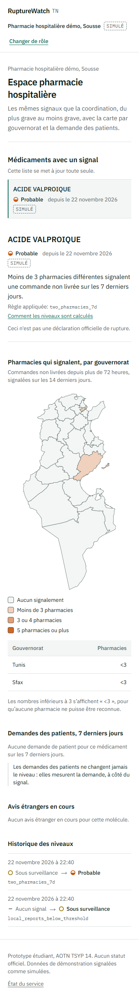
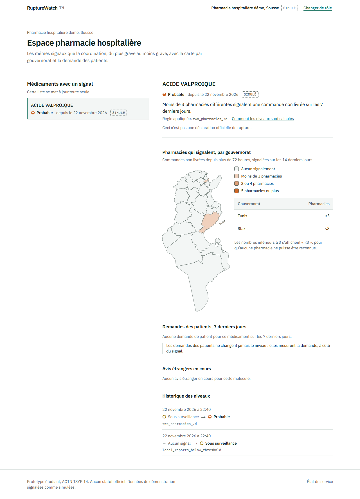
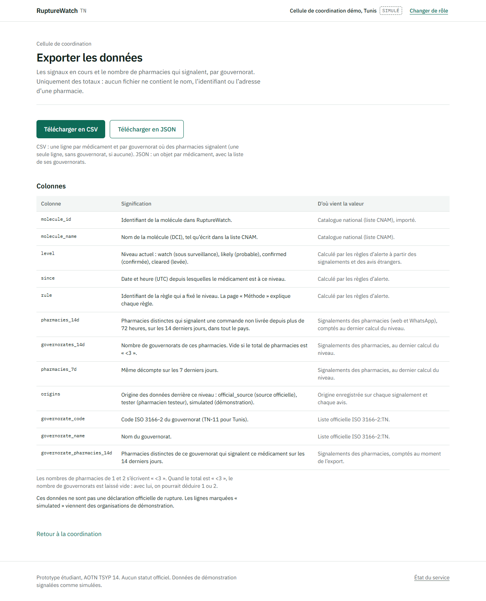
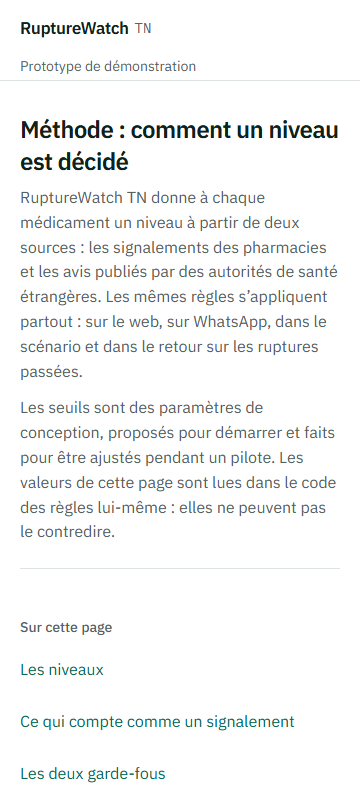
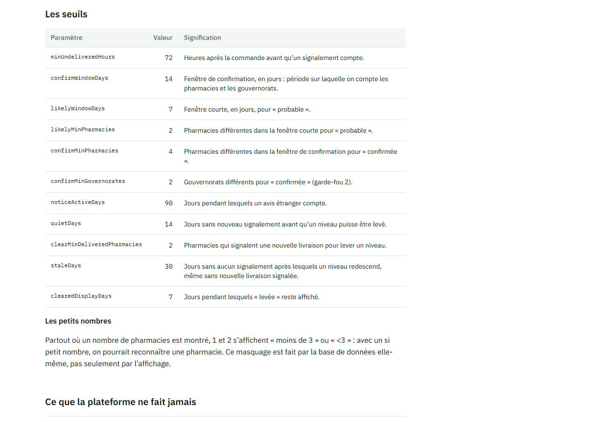
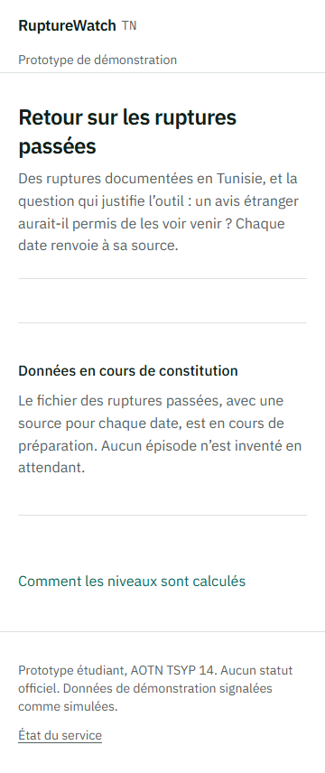
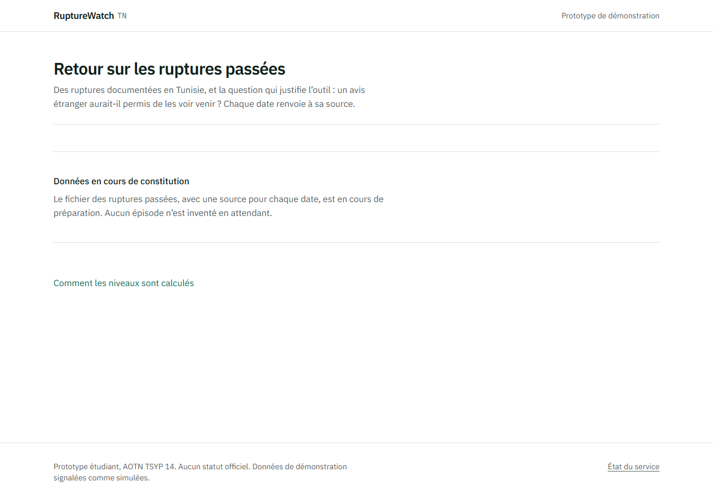
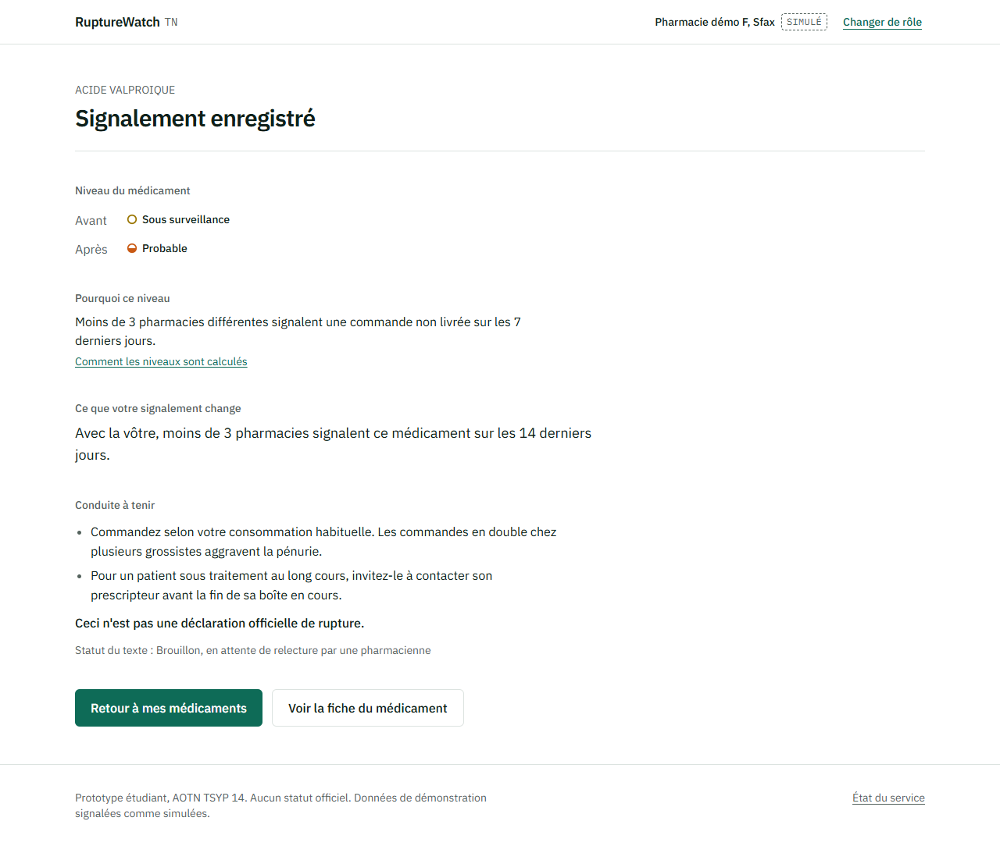
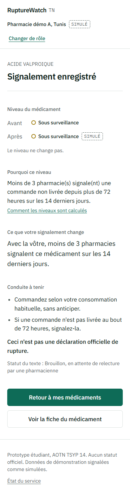
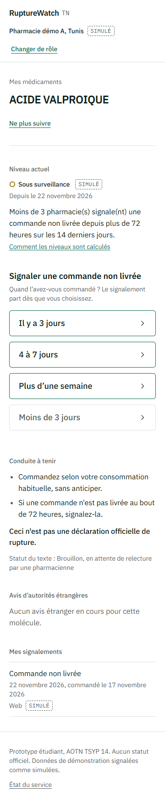
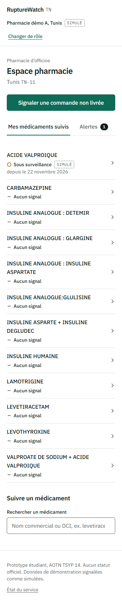
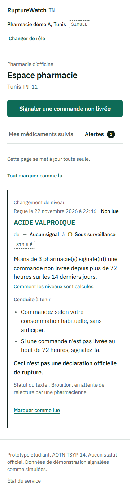
