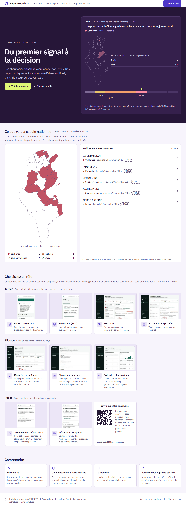
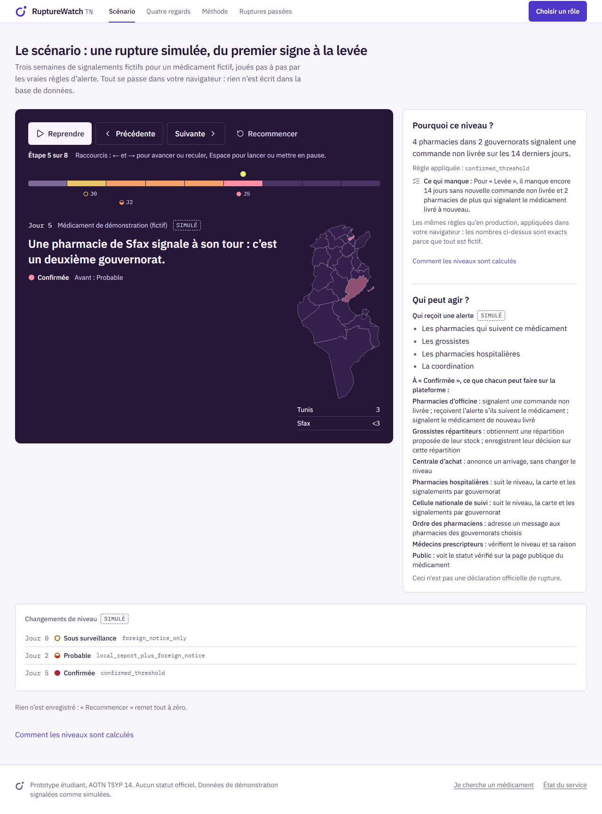

# Session 6 report: the decision layer, and a visual pass

Track A. Brief: `docs/briefs/session-6.md`. Spec: `docs/RUPTUREWATCH-CLAUDE-CODE-HANDOFF.md`.

## For the merge decision: branch `ui-refresh`

- **Branch:** `ui-refresh`, pushed, not merged. Head `c6059ac`, which contains `main` up to `7ead796` (every part of this session, part 7 included), so it merges without conflict today. One conflict came up in that merge, on the public medicine page, and was resolved by keeping both changes: the branch's "Simulation" flag and main's freshness line. On the merged branch: `npm run check` passes (630 tests) and `next build` passes.
- **The screenshots below predate the last merge.** They show the branch before part 8 items 4 to 8 and 10 and part 7 reached it. I could not retake them on `c6059ac`: the system stopped the local server for low memory, and I did not restart it. The same features are shown on main's design further down, in the part 8 and part 7 sections.
- **Preview link:** I could not read it from this session. There is no GitHub CLI on this machine, the repository is private, and reading the stored GitHub credential was refused by the session's permissions. Vercel builds every pushed branch. Open the Vercel project, then Deployments, then the latest deployment of branch `ui-refresh`; or use "View deployment" beside the branch's last commit on GitHub. **Please paste the link here.**
- **What I verified instead.** The same production build Vercel runs (`next build`) passes on the branch head. The screenshots below come from that build (`next start`, live Supabase project, demo accounts). If the preview shows "La vue nationale n'est pas disponible", the Supabase variables are not exposed to the Preview environment in Vercel.

### Screenshots (branch head, 360 and 1280 px)

| Page | 360 px | 1280 px |
| --- | --- | --- |
| Home `/` | [home-360](session-6/home-360.png) | [home-1280](session-6/home-1280.png) |
| Scenario on entry | [scenario-360](session-6/scenario-360.png) | [scenario-1280](session-6/scenario-1280.png) |
| Scenario, step 5 ("confirmée", reached with the → key) | [scenario-step5-360](session-6/scenario-step5-360.png) | [scenario-step5-1280](session-6/scenario-step5-1280.png) |
| Pharmacy `/pharmacie` | [pharmacie-360](session-6/pharmacie-360.png) | [pharmacie-1280](session-6/pharmacie-1280.png) |
| Split `/grossiste/repartition/<LEVETIRACETAM>` | [repartition-360](session-6/repartition-360.png) | [repartition-1280](session-6/repartition-1280.png) |
| Public medicine page, French | [medicament-fr-360](session-6/medicament-fr-360.png) | [medicament-fr-1280](session-6/medicament-fr-1280.png) |
| Public medicine page, Arabic | [medicament-ar-360](session-6/medicament-ar-360.png) | [medicament-ar-1280](session-6/medicament-ar-1280.png) |

### What changes on the branch

- **Palette.** Plum stage and console rail `#261638`, lavender paper `#F7F4FC`, violet action `#4D36C8`, citron `#DFF576` on plum only. Level colours: watch `#8B5900`, probable `#A94412`, confirmée `#AE233A`, levée `#216D54`, with lighter tints on plum. Every ratio was checked with the WCAG formula; they are listed in `app/globals.css` and `docs/DECISIONS.md`. Shapes and words are kept for every level.
- **Home.** A 5/7 plum stage carries "Démonstration · données simulées", "Du premier signal à la décision", one sentence, the citron "Voir le scénario" and "Choisir un rôle". On the right is one frozen moment of the scenario, computed from `scenarioFrames()`: the step where it reaches "confirmée", the two governorates that reported on the map ("3" and "<3"), the state line and its source. At 360 × 800 the button is in the first screen. Below come "Ce que voit la cellule nationale", the roles in three groups, and "Comprendre". The separate scenario band is gone; the stage replaces it.
- **Scenario.** Two regions. On plum: play, previous, next and restart together, "Étape n sur 8", a "Raccourcis" line, the state timeline annotated at each level change (steps still to come stay blank), and the event that just happened, with the map. Beside it: "Pourquoi ce niveau ?" (the rule, its explanation, "Ce qui manque" with exact counts because the scenario is fictional) and "Qui peut agir ?" (who is alerted, then what each role can do at this level, read from the same table as the playbook). Manual by default. ← and → step; Space plays or pauses. One short pulse on a level change; nothing moves under reduced motion.
- **Pharmacy.** The install help is only under "Plus". The 72-hour rule is stated at the timing choice, with its number read from `params.ts`. The result screen reads "Signalement reçu", "Ce que votre signalement a changé", "Prochaine action". The animated count-up is removed: the guardrails forbid animated counters. The two taps are unchanged.
- **"Simulation"** appears in the heading block of the public medicine page (FR and AR) and of the split page, when what is shown is simulated.
- **Docs.** `CLAUDE.md` §9 and `AGENTS.md` are rewritten for this direction. The decision is in `docs/DECISIONS.md`. All texts are in `messages/fr` and, for public pages, `messages/ar`.

## Done checks

| Check | Result |
| --- | --- |
| 1. `verify:clean` removed Monday's test rows; the live demo shows only the national picture | **Passed.** Removed: the patient request from end-to-end test 4 (AMLODIPINE, Tunis, 23 Nov 20:46 UTC, origin `tester`) and the one answer a one-click demo pharmacy gave. No stray reports, arrivals or Ordre messages were found. The tester numbering restarted at 1. Two new options made this possible (`0dab1de`): answers by the one-click pharmacies are removed, and `--requests` removes patient requests made by an end-to-end run. |
| 2. The showcase "confirmée" medicine is an antiepileptic; `demo:clear` then `demo:national` leaves the fingerprint identical | **Passed** (`efdbce4`). LEVETIRACETAM: six CNAM brands (Antiomal, Epilepta, Epitam, Epixx, Levet, Vetira) and no data of its own on the live project. Fingerprint identical after clear. Carbamazepine was not used because it has a real archived episode (Tégrétol LP, December 2022); the reason is in DECISIONS. The other four showcase medicines are unchanged. Previews were regenerated. |
| 3. On the deployed site, changing the stock updates both results; the minimum days come from the code; the allocation tests pass | **Passed** (`809113e`), on the deployed site: 11,0 / 17,3 days at 2,500 boxes, 5,5 / 11,3 at 1,000, 30,0 / 30,0 at 20,000; "Voir les 24 gouvernorats" shows 24 rows. `tests/allocation-compare.test.ts` passes. |
| 3b. The handoff's figures | **Confirmed by the code, no difference.** At 2,500 boxes: 250 reserved, 2,250 allocated under both splits, lowest cover 11.0 days (proportional) against 17.3 (by days of cover), from 2.0 before. "Stock nécessaire pour viser 14 jours": 1,604 boxes (160 reserve, 1,444 to share); 1,603 falls short. |
| 4. The playbook opens from `/methode` and the three links; its parameters match `params.ts`; every clause says it awaits validation and names only a role | **Passed** (`6448e56`, `de8f005`). `/methode/protocoles/levetiracetam`, from the "Protocoles par médicament" section of `/methode`. "Voir le protocole appliqué" appears on the coordination and hospital medicine panel, the split page and the pharmacy's alert, for LEVETIRACETAM only, each reading "Paramètres actuels". `tests/playbooks.test.ts` checks that the playbook's parameters are the same objects as `DEFAULT_PARAMS` and `ALLOCATION_PARAMS`, and that the file types no other number. The three clauses have no text and name roles only. |
| 5. "Ce qui manque" shows on the three panels, never a count under 3 on real data | **Passed** (`0546c33`). On the deployed site, coordination LEVETIRACETAM shows "Pour « Levée », il manque encore 14 jours sans nouvelle commande non livrée et des signalements « livré à nouveau » d'au moins 2 pharmacies." The prescriber check on TAMOXIFENE shows "Pour « Confirmée », il manque un deuxième gouvernorat." The hospital panel uses the same component. `tests/missing.test.ts` runs every small case and allows no count of pharmacies on real data. |
| 6. The preview builds; screenshots; Lighthouse accessibility 100 | **Partly verified.** The production build passes on the branch head, but the Vercel preview itself was not seen (see the top). Screenshots are above. Lighthouse 12 accessibility, run on the local production build of the branch, phone and desktop: **100** on `/`, `/scenario`, `/medicaments/<LEVETIRACETAM>` in French and Arabic, `/pharmacie` and `/grossiste/repartition/<LEVETIRACETAM>`. The split page first scored 93 (a `<dl>` with wrapped groups, from part 3); fixed in `15a13b4` and cherry-picked to main as `521111c`. Reflow checked at 320, 390, 768 and 1440 px on `/`, `/scenario` and the public medicine page: no horizontal scroll. After part 8 and part 7, on main (local production build of `802bcda`): **100** on `/` (phone and desktop), `/scenario` (with "Comparer les cas"), the public medicine page in French and Arabic (freshness, 90-day strip, share), and the signed-in `/coordination` (feed, Ctrl+K), phone and desktop. |
| 7. `npm run check` passes on `main` and on the branch | **Passed.** On main at the end of part 5 (`0546c33`): 598 tests; at the end of the session (`7ead796`): **627 tests**. On the branch after merging main (`c6059ac`): lint, types, **630 tests**, and `next build`. End-to-end test 3 (scenario, now also stepping with ← and →) passed against the branch build at `00c5650`. |

## Part 8: small additions

Items 2 and 3 were done by a second session working in parallel on `main` (worktree `C:\Users\fatna\AOTN-main-wt`). It started item 4, then stopped answering. Its worktree was left untouched: `main` is checked out there, with uncommitted item 4 files that `3fdbc7b` now supersedes, so it can be removed. This session finished item 4, then did items 5 to 8, 10 and part 7, all on `main`. Item 9 was built into the rewritten scenario player on `ui-refresh`, since doing it on main would only have conflicted. "Deployed" below means checked on https://rupturewatch-tn.vercel.app at the commit named, with `/api/health` reporting that commit.

| Item | Result |
| --- | --- |
| 1. Rule 10 on the home page | **Done on main** (`5456c5b`). The picture is framed as "Ce que voit la cellule nationale", with "Démonstration · données simulées" beside it and one sentence saying the public sees only a confirmed shortage. `loadNationalPicture()` keeps only signals whose evidence is entirely simulated (`isDemonstrationSignal`, tested in `tests/home-national.test.ts`): a tester or official signal never appears there, at any level. On the deployed site (`521111c`): the framing is shown, and only the five simulated showcase medicines are listed. |
| 2. Hint strip per role | **Done on main** (`65869c0`, parallel session). Checked deployed (`7ead796`) in a browser for the ministry ("Essayez : choisir un médicament dans la liste, puis lire pourquoi il a ce niveau et ce qui manque pour le suivant."), the pharmacy ("… signaler un médicament commandé et non livré, en deux gestes", with a "Signaler" link) and the wholesaler ("… changer le stock et comparer les deux répartitions"). After dismissing it and reloading, it stays hidden: the dismissal is kept in the browser only. |
| 3. QR codes | **Done on main** (`569ea52`, `ad38d77`, parallel session). Deployed: the home page shows "Ouvrir sur votre téléphone" with a QR code labelled "Code QR vers la recherche de médicaments sur ce site" and the address `rupturewatch-tn.vercel.app/medicaments`. `/coordination/invitation` shows the invitation QR. The library is recorded in DECISIONS. |
| 4. "Partager ce statut" and a card per medicine | **Done on main** (`3fdbc7b`; started by the parallel session, finished and checked here). Web Share API when the phone has it, otherwise "Partager sur WhatsApp" and "Copier le lien". Deployed, LEVETIRACETAM: `og:description` reads "Rupture confirmée depuis le 14 novembre 2026. Simulé : données de démonstration, pas des signalements réels. Ceci n'est pas une déclaration officielle de rupture." The deployed card image (1200 × 630) shows the name, "Rupture confirmée depuis le 14 novembre 2026.", the Simulé badge with its sentence, and the line. For TAMOXIFENE ("probable"), the shared text is "Aucune rupture confirmée à ce jour", and "probable" appears nowhere. `tests/share.test.ts`. |
| 5. Freshness | **Done on main** (`e6a5cbc`, migration 0023 applied, schema 23). "Mis à jour il y a …" under the public status and on the ministry, hospital and wholesaler panels, from `signals.updated_at` (set at every evaluation, the daily recompute included), with the exact time in the tooltip. `public_molecule_status` gives the time only for a shown level, so below "confirmée" there is none (database test). Deployed: LEVETIRACETAM reads "Mis à jour il y a 1 h". TAMOXIFENE ("probable") shows no "Mis à jour", no "probable" and no "sous surveillance". `tests/freshness.test.ts`. |
| 6. 90-day public status strip | **Done on main** (`bcce6be`, migration 0024 applied, schema 24). `LevelBand` with French or Arabic words and only three public levels, with the text list under it. The data comes from a new `public_molecule_history` function, which keeps only changes of the public level, so a "probable" period leaves no trace, not even its date. Database tests use a molecule that went through "sous surveillance" and "probable". Deployed: LEVETIRACETAM shows "Les 90 derniers jours", "Rupture confirmée depuis le 14 novembre 2026" and the note "Seules les périodes de rupture confirmée puis levée apparaissent ici". TAMOXIFENE shows "Aucune rupture confirmée sur les 90 derniers jours". |
| 7. Last five level changes | **Done on main** (`1e77ca4`). In the ministry's space, beside the national map, and in the home page's picture: medicine, change as shape and word, "Il y a 3 j", pharmacies over 14 days as shown, rule id, origin badges. "Moins de 3 pharmacies" below 3, with no number of governorates then; never a pharmacy. On the home page, only changes whose evidence is entirely simulated, for demonstration medicines (item 1's frame). Deployed: the home feed lists METFORMINE, CIPROFLOXACINE, TAMOXIFENE, LEVETIRACETAM ("4 pharmacies dans 2 gouvernorats sur 14 jours") and TAMOXIFENE, "Il y a 3 j" to "Il y a 10 j". `tests/recent-changes.test.ts`. |
| 8. Skeleton loading | **Done on main** (`9611060`, `7ead796`). Grey bars in the page's shape, one status line in words, still under reduced motion: consoles, pharmacy app, patient answers page (French and Arabic). The first version only showed when entering a space, so each space now has its own loading file. Deployed, with the next page's data held for 5 s: the ministry (to "Note de situation") and the pharmacy (to "Mes médicaments") both show "Chargement de la page…" and the bars, and the bars are gone once the page loads. The answers page skeleton was checked on a local build only: reaching it on the deployed site means sending a real patient request. |
| 9. Keyboard in the scenario | **Done on `ui-refresh`** (`badf314`). ← and → step, Space plays or pauses (except on a focused button, which keeps its own Space), shown in a "Raccourcis" line. Checked by end-to-end test 3 and by the step-5 screenshots, which were reached with five presses of →. |
| 10. Ctrl+K (optional) | **Done on main** (`78a3627`). In the ministry, hospital and wholesaler consoles: Ctrl+K (Cmd+K), or the "Aller à un médicament" button, opens a dialog that searches the catalogue (`search_molecules`, `search_medicines`), accents or not. A medicine with a level in this space opens its panel, and Enter opens the first one. A medicine without a level here reads "Aucun niveau ici" and is not a link. Deployed: "ebefen" in the ministry finds TAMOXIFENE ("trouvé par la marque EBEFEN", Probable), and Enter opens its panel. "lévé" in the hospital finds LEVETIRACETAM (Confirmée) first. `tests/quick-search.test.ts`. |

| Freshness and strip, French and Arabic (360 px) | Feed in the ministry's space (1280 px) | Feed on the home page (360 px) |
| --- | --- | --- |
| [p8-status-fr-360](session-6/p8-status-fr-360.png), [p8-status-ar-360](session-6/p8-status-ar-360.png) | [p8-feed-coordination-1280](session-6/p8-feed-coordination-1280.png) | [p8-feed-home-360](session-6/p8-feed-home-360.png) |

| Ctrl+K, deployed (1280 px) | Skeletons, deployed |
| --- | --- |
| [p8-ctrlk-1280](session-6/p8-ctrlk-1280.png) | [ministry 1280](session-6/p8-skeleton-coordination-1280.png), [pharmacy 360](session-6/p8-skeleton-pharmacie-360.png) |

Screenshots marked "deployed" come from the production site. The others come from a local production build of the same commit.

## Part 7: "Comparer les cas"

**Done on main** (`802bcda`), under the player on `/scenario`. Two named cases, "Signal réparti" and "Signal concentré". The same four fictional pharmacies report on days 1 to 4; only the fourth one's governorate changes (Sfax or Tunis), and that step says it is the one data that differs. A visitor can switch case at any step: the step stays, and "À cette étape, dans les deux cas" shows both levels. Then comes the same recovery in both cases. On day 10 a wholesaler announces an arrival, an upstream event that changes no level, and the page says so. On days 19 and 20, two pharmacies report the medicine delivered again, and the level becomes "levée". The rule id is shown under each level. "Ce qui manque" uses exact counts, since the cases are fictional. A line computes the pilot scale from `params.ts`, and a link opens the threshold explorer on `/methode`. It runs `evaluate()` in the browser, is deterministic, and writes nothing.

| Acceptance (handoff C) | Result |
| --- | --- |
| Four qualifying reports in one governorate remain "probable" | **Passed.** Day 4, concentrated case: "Probable", `single_governorate_cap`, "Ce qui manque : Pour « Confirmée », il manque un deuxième gouvernorat." |
| Moving one report to a second governorate, same total, supports "confirmée" at pilot scale | **Passed.** Day 4, spread case: "Confirmée", `confirmed_threshold`, "4 pharmacies dans 2 gouvernorats". The page states the scale: 4 pharmacies up to 200 active members, then 2 %. |
| Only the geography changes; same pharmacies and window | **Passed.** `tests/compare.test.ts`: same days and steps in both cases; only step 4's governorate differs. |
| Switching and resetting are deterministic and browser-only | **Passed.** Deployed: day 4 spread "confirmed" → switch → "likely" → arrival, still "likely" → day 20 "cleared" → "Recommencer" back to step 0. Same frames on every run (test). |
| Earlier replay and reset still work | **Passed.** The scenario player is unchanged. `npm run check` passes (627 tests). |

Screenshots: [p7-compare-spread-360](session-6/p7-compare-spread-360.png) (deployed) and [p7-compare-concentrated-1280](session-6/p7-compare-concentrated-1280.png) (local build of the same commit).

## Video demo path (showcase now LEVETIRACETAM)

1. Phone A, the patient, in a private window: open https://rupturewatch-tn.vercel.app/medicaments, type "leve", tap LEVETIRACETAM. The page says "Rupture confirmée depuis le …" with its Simulé badge (and, once the branch is merged, "Simulation" under the name).
2. Tap "Demander aux pharmacies proches", choose "Tunis", tap "Envoyer la demande". The answers page opens and waits for the pharmacies.
3. Phone B, the pharmacist: open https://rupturewatch-tn.vercel.app, "Pharmacie (Tunis)". "Mes médicaments" says a patient is waiting. Tap "Répondre".
4. On the LEVETIRACETAM request, tap "Disponible, me montrer au patient".
5. Back on phone A, without touching it: within 10 seconds, "Pharmacie démo A, Tunis" appears on the map and in the list.
6. For the decision layer: "Grossiste", the split page from the LEVETIRACETAM panel. Change the stock and both results move. Then "Voir le protocole appliqué".
7. For gate two: `/scenario`, "Comparer les cas", press "Suivante" four times, then switch between "Signal réparti" and "Signal concentré": "Confirmée" against "Probable", with the same four pharmacies.

A phone can ask for a medicine once a day: for a second take, use another private window. After filming, `npm run verify:clean -- --since <start> --requests --apply` removes the request and the answer. The showcase itself is never reset.

## Notes for the lead

- **Preview link** missing; see the top.
- **Two migrations applied to the live project** tonight, each before the code that reads it was pushed: `20261124000000_public_status_evaluated_at.sql` (0023, `public_molecule_status` gains `evaluated_at`) and `20261124000100_public_molecule_history.sql` (0024, `public_molecule_history`). `/api/health` reports schema 24.
- **The parallel session's worktree** `C:\Users\fatna\AOTN-main-wt` is still there, with uncommitted item 4 files that `3fdbc7b` supersedes. Nothing in it is needed. `git worktree remove --force ..\AOTN-main-wt` from `AOTN` removes it.
- **Memory.** Near the end, the system stopped the local `next start` server because memory was low. I did not restart it. That is why the branch screenshots were not retaken after the last merge (see the top).
- **End-to-end tests changed.** Test 1 reports the first followed medicine other than the showcase, because the one-click pharmacies now follow LEVETIRACETAM. Test 4 asks for LEVETIRACETAM. On `ui-refresh`, test 2 expects the new result headings ("Signalement reçu", "Ce que votre signalement a changé"), and test 3 also steps with the arrow keys. Only test 3 was run in this session, against the branch build; tests 1, 2 and 4 write to the live project and were not run. Part 8 and part 7 were checked with scripted browsers on the deployed site instead. I read the end-to-end selectors against the new elements (feed, Ctrl+K button, comparison), and none collide.
- **Lighthouse note.** Lighthouse lists "label-content-name-mismatch" on the pharmacy's medicine rows (`aria-label="Ouvrir la fiche de …"`). The audit carries no weight and the score is 100; the same pattern on the home list was fixed on the branch. The pharmacy rows predate this session.
- **CLAUDE.md §3** still says 31 tests in `tests/signal.test.ts`; there are 43 since session 5.
- **Machine.** A stale `next dev` server from an earlier session was killed at the start of this session.
