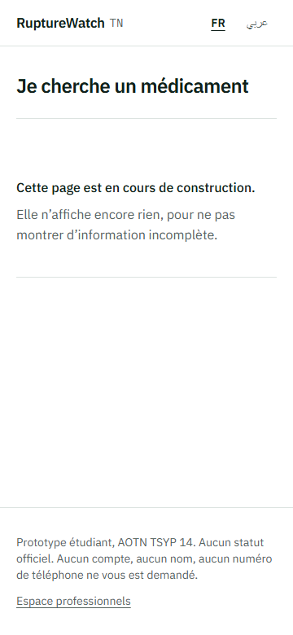
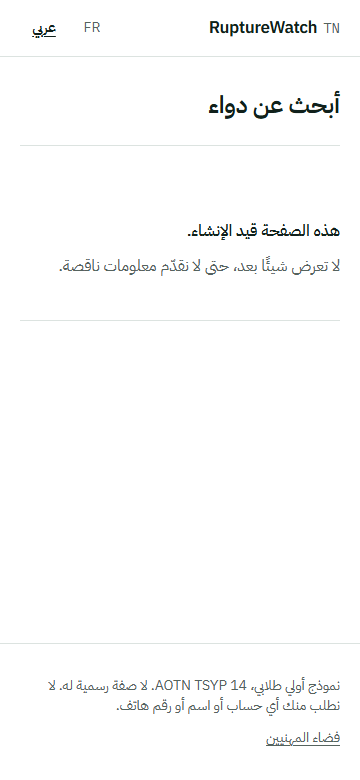
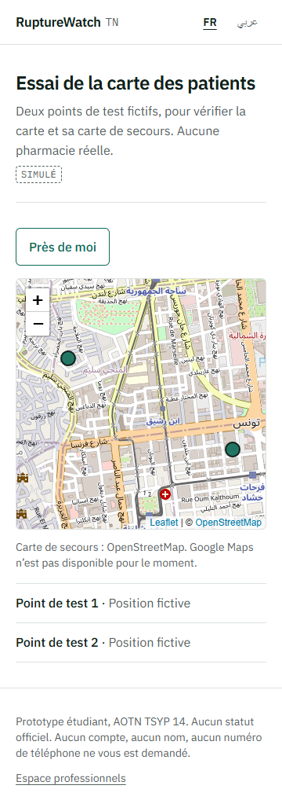
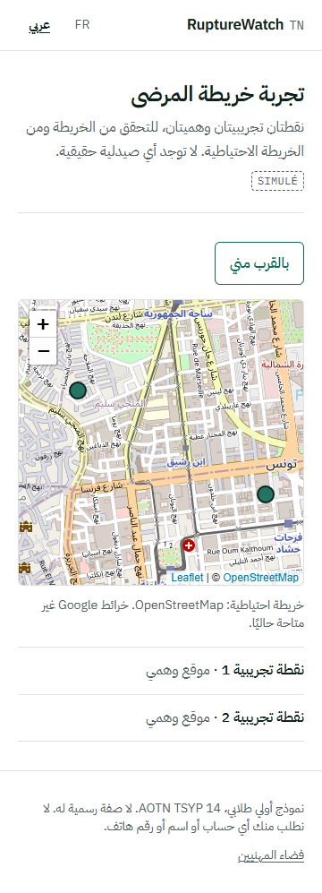

# Shared foundations report

Status: **done checks pass on the deployed site** (https://rupturewatch-tn.vercel.app, commit `12019b5`). The pieces tracks B, C and D build on are on `main`.

**Delay.** Sections 1 to 3 were pushed at 03:00 on Sunday 22 November. The session then stopped (the computer was shut down) before the patient map and the contributing guide were committed. They were finished and pushed at 20:26 the same day. **A teammate who branched from `main` before 20:26 does not have `components/maps/PatientMap.tsx`, `app/api/places/nearby/`, `docs/CONTRIBUTING.md` or the pull request template, and should run `git fetch origin` then `git merge origin/main`.** Nothing in the earlier commits changed.

## 1. Done checks

| # | Check | Result | How it was verified |
| --- | --- | --- | --- |
| 1 | `t()` works across the split files; existing pages show the same French text; lint and tests pass | **Pass** | Every one of the 242 keys of the former `messages/fr.json` exists under `core.` in `messages/fr/core.json` with the same text (script comparing the two, 0 differences; one key was added since). `tests/i18n.test.ts`: namespaced keys resolve, Arabic falls back to French with a development warning, unknown keys throw. `npm run check`: lint, type check and 283 tests in 19 files pass. Home page checked on the deployed site. |
| 2 | `/medicaments` renders in French and in Arabic, right to left, at 360 px | **Pass** (deployed) | Headless Chrome, 360 × 780. French: `lang="fr"`, `dir="ltr"`. With the `rw-lang=ar` cookie: `lang="ar"`, `dir="rtl"`, title "أبحث عن دواء", IBM Plex Sans Arabic, no horizontal scroll (page width 360). Screenshots 01 and 02. |
| 3 | The migration applies on the live project; access tests prove the four rules | **Pass** | Migration 0010 is applied: `/api/health` reports schema version 10. `tests/db/availability.test.ts` (real SQL on PGlite): a pharmacy cannot read `availability_requests` and `requests_for_my_pharmacy` returns no device hash; `request_answers_public` returns only pharmacies that said "available" and chose to show themselves; demand and answer counts under 3 come back as `<3`; a second request for the same molecule from the same device within 24 hours is refused, and accepted again after 24 hours. On the live project, with the public key: `demand_by_governorate` and `create_availability_request` are refused ("permission denied"), selecting from `availability_requests` is refused, and `request_answers_public` returns nothing for an unknown request. |
| 4 | `PatientMap` shows the OpenStreetMap fallback with two test markers when no Google key is set | **Pass** (deployed) | `/dev/carte` (not linked from the interface): `data-provider="osm"`, two markers, attribution "Leaflet \| © OpenStreetMap", the "Carte de secours" note, in French and in Arabic (the map itself stays left to right). Screenshots 03 and 04. `/api/places/nearby` answers 503 `places_unavailable` with no key set (deployed, and `tests/places-route.test.ts`). |
| 5 | `docs/CONTRIBUTING.md` and the pull request template are on `main` | **Pass** | Commit `12019b5`: `docs/CONTRIBUTING.md`, `.github/pull_request_template.md`. |

## 2. What was built

**Message files by track** (`messages/fr/{core,public,directory,library,wholesaler}.json`, `messages/ar/{public,directory,library}.json`). Keys are used with their namespace (`t('public.pages.medicines.title')`), the file holds them without it. Public pages use `getTranslator()` on the server and `translator(locale)` in client components. A key missing in Arabic shows the French text and warns once in development.

**Public layout** (`app/(public)/`): its own root layout (no sign-in), the language switch FR / عربي stored in the `rw-lang` cookie, `lang` and `dir` on `<html>`, IBM Plex Sans Arabic for Arabic, `<Ltr>` to keep medicine names and codes readable inside Arabic text. The professional spaces moved to `app/(site)/` with unchanged addresses. Placeholder pages with an honest "en cours de construction" state: track B `/medicaments`, `/medicaments/[moleculeId]`, `/demandes/[requestId]`, `/ruptures-passees`, `/prescripteurs`; track C `/pharmacies`, `/bibliotheque`, `/bibliotheque/[moleculeId]`. The home page links to "Je cherche un médicament".

**Availability requests and answers** (migration `20261122001000_availability.sql`, applied live): `availability_requests`, `availability_answers`, `organisations.latitude`, `longitude`, `public_address`, fictional positions for the 12 demo pharmacies (in `supabase/seed/demo-organisations.json`, each at least 150 m from any pharmacy listed in OpenStreetMap). Functions `create_availability_request` (service role only, after our server hashes the device id with `lib/availability/device.ts`), `requests_for_my_pharmacy`, `request_answers_public`, `demand_by_governorate`. Nothing seeded.

**Patient map** (`components/maps/PatientMap.tsx`): Google Maps JavaScript API with Google's attribution when `NEXT_PUBLIC_GOOGLE_MAPS_API_KEY` is set; Leaflet with OpenStreetMap tiles and attribution when the key is absent, the script fails or times out (8 s), or Google refuses the key. Same props for both: markers, centre, zoom, `onPosition`, `onProvider` (so a page can keep Google Places results off the fallback map, rule 13). "Près de moi" asks the browser for the position only when tapped; the position moves the map and is handed to the page, never sent to our server by the component. Popups are built as text, never as HTML.

**Places route stub** (`app/api/places/nearby/route.ts`): reads `GOOGLE_PLACES_API_KEY` on the server, answers 503 with a clear message without it, never cached (`Cache-Control: no-store`), excluded from the session middleware. Track C fills it in.

**`.env.example`**: `NEXT_PUBLIC_GOOGLE_MAPS_API_KEY` (restrict by HTTP referrer to our domains, Maps JavaScript API only, daily cap), `GOOGLE_PLACES_API_KEY` (server only, Places API (New) only, daily cap), `NEXT_PUBLIC_GOOGLE_MAPS_MAP_ID`, `DEVICE_HASH_SALT`.

**Contributing** (`docs/CONTRIBUTING.md`): one branch per track, route folders and message namespaces per track, shared pieces owned by the team lead, migrations written in the branch and applied only by the team lead (named with their creation time and track to avoid collisions), Vercel preview per pull request, previews share the live database. Pull request template with the checklist and "screenshots at 360 px".

## 3. Decisions

In `docs/DECISIONS.md` under "2026-11-22, shared foundations": message files by namespace; two root layouts; the availability tables and functions; the patient map, with the new dependencies `leaflet`, `@types/leaflet` and `@types/google.maps`.

## 4. Open questions

1. **Arabic texts.** The Arabic strings of the public shell and the map were written by the developer, not a translator. They need review by an Arabic speaker before the jury sees them.
2. **Track B's pharmacy answer screen** is placed in `app/(site)/(espace)/pharmacie/demandes/` in `CONTRIBUTING.md`, inside the pharmacy space that track A owns. Confirm that with the track B teammate, or move it.

## 5. Manual steps for the team lead

1. **Tell the teammates to merge `main`** if they branched before 20:26 on Sunday (see the delay note at the top).
2. **Google Cloud** (from the plan): create the browser key (HTTP referrers `https://rupturewatch-tn.vercel.app/*` and the Vercel preview domain, Maps JavaScript API only, daily cap) and the server key (Places API (New) only, daily cap), a map ID (Map Management), and a budget alert. Then in **Vercel → Settings → Environment Variables**, for Production and Preview: `NEXT_PUBLIC_GOOGLE_MAPS_API_KEY`, `NEXT_PUBLIC_GOOGLE_MAPS_MAP_ID`, `GOOGLE_PLACES_API_KEY`, and redeploy. Until then the map shows the OpenStreetMap fallback, which is tested.
3. **Vercel → Settings → Environment Variables → Preview**: check that the Supabase variables and `DEVICE_HASH_SALT` are also set for Preview, or the teammates' preview deployments will fail at their first database call.
4. `DEVICE_HASH_SALT` on Vercel (Production and Preview) before track B ships the request flow: a long random string, the same value as in `.env.local`.

## 6. Screenshots

All at 360 px, on the deployed site. Files in `docs/reports/shared-foundations/`.

