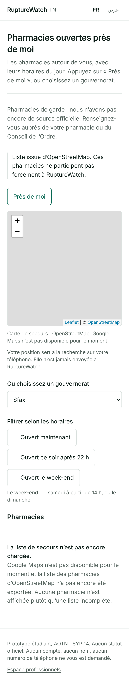
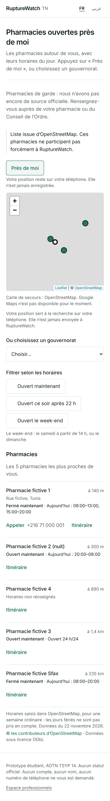
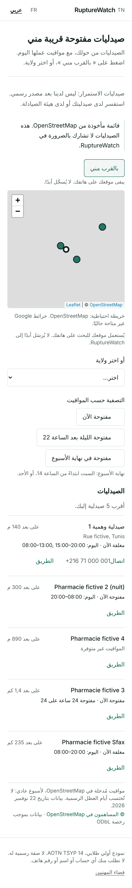
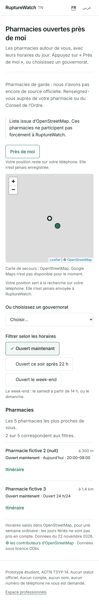
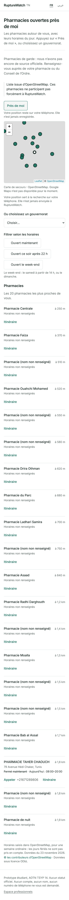
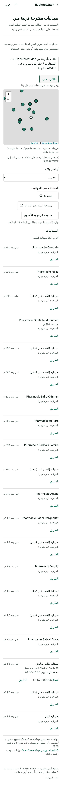
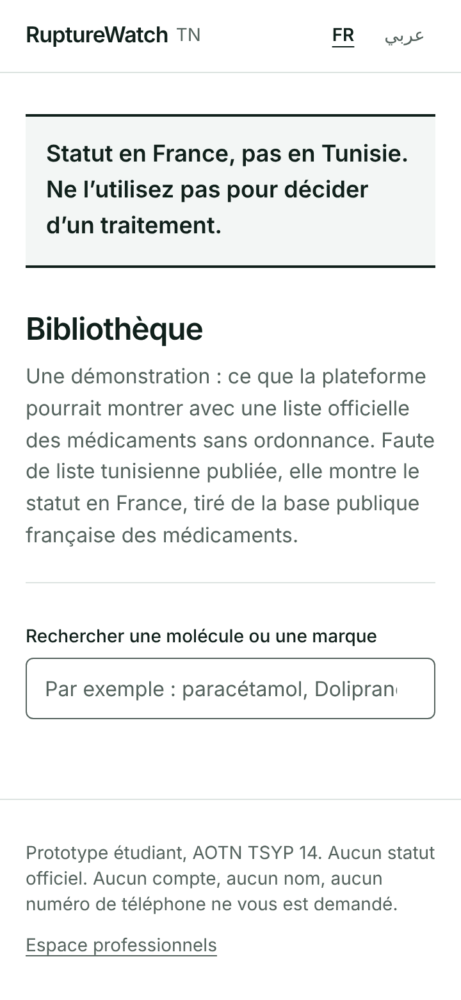
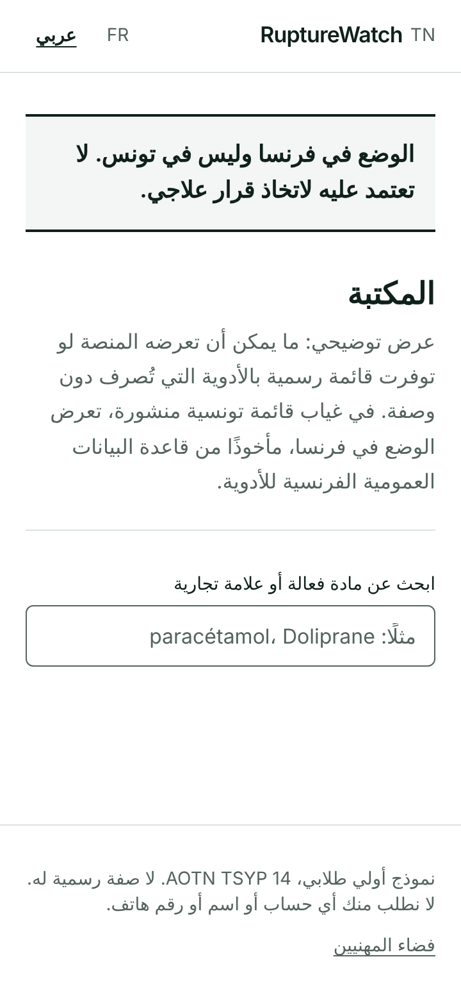

# Track C report: pharmacies open near me, and the Library

Status: **built, tested, not yet checked on a Vercel preview.** `npm run check` passes (lint, type check, 392 tests in 30 files). The work was done in a workspace that cannot reach Overpass, the French medicines database, Google or Supabase, so three things are still to do on a machine with network access before the done checks can pass (section 5): run the two data exports, set the Google browser key's API list, and check the deployed preview.

## 1. Done checks

| # | Check | Result | How it was checked |
| --- | --- | --- | --- |
| 1 | With the Google key, "Près de moi" shows nearby pharmacies with open-now status and hours; "Ouvert maintenant" works; no request to our server carries coordinates or Google data | **Not checked** | No Google key and no access to Google here. The code path is written against the Maps JavaScript API types (`Place.searchNearby`, `Place.searchByText`), and the conversion of Google periods, open-now and the filters is unit tested (`tests/directory-hours.test.ts`, `tests/directory-data.test.ts`). In Google mode the page makes no request to our server at all. Check on the preview once the key allows Places API (New). |
| 2 | Without the key, the OpenStreetMap list appears, sorted by distance, with the attribution | **Pass locally, real data** | Real export of 23 November 2026 (798 pharmacies). Local production build at 360 px, headless Chrome. "Près de moi" from central Tunis: the 20 nearest, from 1.4 km, with today's hours where OpenStreetMap has them (180 of 798) and "Horaires non renseignés" otherwise. Sfax from the list: the 20 nearest to where its 152 pharmacies cluster, including a night pharmacy shown "Ouvert maintenant" at 00:40. "© les contributeurs d’OpenStreetMap" and the data date under the list, French and Arabic. Requests to our server: the page, a link prefetch and `/api/places/osm`, none with a position (screenshots c06, c07). Earlier check with fictional data: screenshots c02, c03. |
| 3 | `/bibliotheque/[id]` for levetiracetam and paracetamol shows the French status with its source and date, under the banner, in French and in Arabic | **Pass locally, real data** | `library-fr.json` built from the real BDPM files (23 November 2026). Local production build at 360 px; no database in the build environment, so for these screenshots only the molecule was looked up by name instead of by id. LEVETIRACETAM: 59 French products, all "Sur ordonnance en France · liste I". PARACETAMOL: 127 products, 122 "Sans ordonnance en France", 5 on prescription. Banner on top, source and download date at the bottom, French and Arabic (screenshots c05). Still to check on the preview with the real molecule ids. |
| 4 | The report lists the 10 products used to check the prescription rule, and how many CNAM molecules matched | **Pass** | Section 3: all ten read as expected; 303 of 548 CNAM molecules matched. |
| 5 | `npm run check` passes | **Pass** | 392 tests, 30 files. 44 new tests; the stub route's 2 tests were removed with the route. |

## 2. What was built

**`/pharmacies`** (`components/directory/PharmacyFinder.tsx`). "Près de moi" (the shared map's button) or a governorate chosen from a list, then up to 20 pharmacies. Filters "Ouvert maintenant", "Ouvert ce soir après 22 h", "Ouvert le week-end", computed on the phone. Each pharmacy: name, address, distance, open or closed now, today's hours ("Ouvert 24 h/24", "Fermé aujourd’hui", "Horaires non renseignés"), "Appeler" (`tel:`) and "Itinéraire". The source line at the top ("Liste issue de Google Maps…" or "…d’OpenStreetMap…") and the garde line, word for word from the brief.
- Google map showing: the search runs in the browser through the Places library (decision in `docs/DECISIONS.md`). Nothing from Google is stored, cached, logged or sent to our server. `app/api/places/nearby/` is deleted.
- OpenStreetMap showing: `/api/places/osm` sends the whole exported list, the phone sorts by distance.
- A governorate from the list: Google text search inside its outline; OpenStreetMap pharmacies inside its outline, nearest to where its pharmacies cluster. Geometric centres were tried first and rejected: several fall far from any town.

**OpenStreetMap export** (`npm run osm:export`): one Overpass query, raw answer saved in `data/raw/osm/`, list in `data/reference/osm-pharmacies.json` with each pharmacy's governorate and regular week (read with `opening_hours`, at export, so phones download no parser). `--from <file>` rebuilds from a saved answer.

**The Library** (`npm run library:import`, `/bibliotheque`, `/bibliotheque/[moleculeId]`): search with the app's catalogue search; for a molecule, the French products with exactly the same substances, each with its French status, the conditions word for word, marketed or not, and the source with its download date. Banner at the top of every Library page. No link to or from the request flow.

**Small pieces:** `data/reference/governorate-areas.json` (`npm run directory:areas`), `lib/directory/` (hours, geometry, entries, the OpenStreetMap file's shape), `lib/library/`.

## 3. The prescription rule: ten known products

Expected French status, to be confirmed by a pharmacist on the team before the result is trusted:

| Product (start of the BDPM name) | Expected | Read by the rule |
| --- | --- | --- |
| KEPPRA 500 mg | prescription (liste I) | OK, prescription · KEPPRA 500 mg, comprimé pelliculé |
| DEPAKINE 500 mg | prescription (liste I) | OK, prescription · DEPAKINE 500 mg, comprimé gastro-résistant |
| AUGMENTIN | prescription (liste I) | OK, prescription · AUGMENTIN 1 g/125 mg, poudre pour suspension buvable en sachet-dose |
| XANAX 0,25 mg | prescription (liste I) | OK, prescription · XANAX 0,25 mg, comprimé sécable |
| SKENAN | prescription (stupéfiant) | OK, prescription · SKENAN L.P. 10 mg, microgranules à libération prolongée en gélule |
| DOLIPRANE 500 mg | no condition listed | OK, no condition · DOLIPRANE 500 mg, comprimé |
| SPASFON, comprimé | no condition listed | OK, no condition · SPASFON, comprimé enrobé |
| SMECTA | no condition listed | OK, no condition · SMECTA 3 g FRAISE, poudre pour suspension buvable en sachet |
| GAVISCON | no condition listed | OK, no condition · GAVISCON NOURRISSONS, suspension buvable en flacon |
| KARDEGIC 75 mg | no condition listed | OK, no condition · KARDEGIC 75 mg, poudre pour solution buvable en sachet-dose |

If all ten agree, products with no condition read "Sans ordonnance en France". If one disagrees or is not found, they read "Statut non déterminé" and the page says why. **All ten agree**, so products with no condition listed read "Sans ordonnance en France". CNAM molecules matched: **303 of 548**; 245 unmatched, shown as "Pas de correspondance dans la base française". Most unmatched names are combinations or substances that the BDPM names with their salt or another form (for example AMIODARONE, which the BDPM lists as a hydrochloride): exact matching leaves them out rather than guess.

## 4. Data sources

In `data/SOURCES.md`: OpenStreetMap (pharmacy export added to its section), the new BDPM section, and the governorate areas file under geoBoundaries. The fetch dates and hashes are marked "not yet" and must be filled in from the scripts' output.

## 5. Manual steps for the team lead

1. **Google Cloud:** on the browser key, add "Places API (New)" to the API restrictions (keep the referrer restriction), enable Places API (New) on the project, and set its daily quota cap. The server key `GOOGLE_PLACES_API_KEY` is no longer used: remove it from Vercel.
2. **The exports were run on 23 November** (results in sections 1 and 3, sources in `data/SOURCES.md`). Commit their outputs:
   - `npm run osm:export` → `data/raw/osm/…`, `data/reference/osm-pharmacies.json`
   - `npm run library:import` → `data/raw/bdpm/…`, `data/reference/library-fr.json`
   Copy the dates, hashes and counts the scripts print into `data/SOURCES.md` and sections 1 and 3 of this report.
3. **Review the files outside track C** listed at the end of the track C entry in `docs/DECISIONS.md` (`core.json`, `tests/method.test.ts`, `next.config.ts`, `.env.example`).
4. **A bug in the shared map, development only:** in `npm run dev`, React runs effects twice and `PatientMap` creates the Leaflet map twice on the same element ("Map container is already initialized"), so the fallback map never appears in development. Production builds are not affected. A fix: check `cancelled` again after `await import('leaflet')` in `createOsmMap`, before `L.map(el)`.
5. Then check items 1 to 3 of section 1 on the Vercel preview at 360 px.

## 6. Open questions

1. **Arabic texts** were written by the developer and need review by an Arabic speaker (section 7). Plural agreement with numbers ("أقرب 5 صيدلية") is not handled.
2. **"Ouvert le week-end"** is defined as Saturday from 14:00 or Sunday. Confirm with a pharmacist that this is what a patient means.
3. **The ten expected statuses** in section 3 come from general knowledge of French listing, not from a source read here. A pharmacist should confirm them.

## 7. Arabic texts for review

| Key | French | Arabic |
| --- | --- | --- |
| `directory.page.title` | Pharmacies ouvertes près de moi | صيدليات مفتوحة قريبة مني |
| `directory.page.intro` | Les pharmacies autour de vous, avec leurs horaires du jour. Appuyez sur « Près de moi », ou choisissez un gouvernorat. | الصيدليات من حولك، مع مواقيت عملها اليوم. اضغط على « بالقرب مني »، أو اختر ولاية. |
| `directory.page.garde` | Pharmacies de garde : nous n’avons pas encore de source officielle. Renseignez-vous auprès de votre pharmacie ou du Conseil de l’Ordre. | صيدليات الاستمرار: ليس لدينا بعد مصدر رسمي. استفسر لدى صيدليتك أو لدى هيئة الصيادلة. |
| `directory.source.google` | Liste issue de Google Maps. Ces pharmacies ne participent pas forcément à RuptureWatch. | قائمة مأخوذة من خرائط Google. هذه الصيدليات لا تشارك بالضرورة في RuptureWatch. |
| `directory.source.osm` | Liste issue d’OpenStreetMap. Ces pharmacies ne participent pas forcément à RuptureWatch. | قائمة مأخوذة من OpenStreetMap. هذه الصيدليات لا تشارك بالضرورة في RuptureWatch. |
| `directory.source.osmHours` | Horaires saisis dans OpenStreetMap, pour une semaine ordinaire : les jours fériés ne sont pas pris en compte. Données du {date}. | مواقيت مُدخلة في OpenStreetMap، لأسبوع عادي: لا تُحتسب أيام العطل الرسمية. بيانات بتاريخ {date}. |
| `directory.source.osmAttribution` | © les contributeurs d’OpenStreetMap | © المساهمون في OpenStreetMap |
| `directory.source.osmLicence` | Données sous licence ODbL | بيانات بموجب رخصة ODbL |
| `directory.where.or` | Ou choisissez un gouvernorat | أو اختر ولاية |
| `directory.where.choose` | Choisir… | اختر… |
| `directory.where.positionHint` | Votre position sert à la recherche sur votre téléphone. Elle n’est jamais envoyée à RuptureWatch. | يُستعمل موقعك للبحث على هاتفك. لا يُرسَل أبدًا إلى RuptureWatch. |
| `directory.filters.legend` | Filtrer selon les horaires | التصفية حسب المواقيت |
| `directory.filters.now` | Ouvert maintenant | مفتوحة الآن |
| `directory.filters.tonight` | Ouvert ce soir après 22 h | مفتوحة الليلة بعد الساعة 22 |
| `directory.filters.weekend` | Ouvert le week-end | مفتوحة في نهاية الأسبوع |
| `directory.filters.weekendHint` | Le week-end : le samedi à partir de 14 h, ou le dimanche. | نهاية الأسبوع: السبت ابتداءً من الساعة 14، أو الأحد. |
| `directory.filters.clear` | Retirer les filtres | إزالة عوامل التصفية |
| `directory.list.heading` | Pharmacies | الصيدليات |
| `directory.list.aroundYou` | Les {count} pharmacies les plus proches de vous. | أقرب {count} صيدلية إليك. |
| `directory.list.aroundGovernorate` | {count} pharmacies dans le gouvernorat de {name}. | {count} صيدلية في ولاية {name}. |
| `directory.list.aroundGovernorateCentre` | Les {count} pharmacies les plus proches du centre du gouvernorat de {name}. Utilisez « Près de moi » pour votre quartier. | أقرب {count} صيدلية إلى وسط ولاية {name}. استعمل « بالقرب مني » للبحث في حيّك. |
| `directory.list.shown` | {shown} sur {total} correspondent aux filtres. | {shown} من أصل {total} تطابق عوامل التصفية. |
| `directory.list.noMatch` | Aucune pharmacie de cette liste ne correspond aux filtres. | لا توجد صيدلية في هذه القائمة تطابق عوامل التصفية. |
| `directory.list.none` | Aucune pharmacie trouvée ici. | لم يُعثر على أي صيدلية هنا. |
| `directory.list.noneBody` | Essayez « Près de moi » depuis un autre endroit, ou un autre gouvernorat. | جرّب « بالقرب مني » من مكان آخر، أو ولاية أخرى. |
| `directory.list.start` | Appuyez sur « Près de moi » ou choisissez un gouvernorat pour voir les pharmacies. | اضغط على « بالقرب مني » أو اختر ولاية لعرض الصيدليات. |
| `directory.list.loading` | Recherche des pharmacies… | جارٍ البحث عن الصيدليات… |
| `directory.list.error` | La recherche n’a pas abouti. Réessayez dans un instant. | لم ينجح البحث. أعد المحاولة بعد لحظة. |
| `directory.list.unnamed` | Pharmacie (nom non renseigné) | صيدلية (الاسم غير مُدخل) |
| `directory.list.openNow` | Ouvert maintenant | مفتوحة الآن |
| `directory.list.closedNow` | Fermé maintenant | مغلقة الآن |
| `directory.list.noHours` | Horaires non renseignés | المواقيت غير متوفرة |
| `directory.list.alwaysOpen` | Ouvert 24 h/24 | مفتوحة 24 ساعة على 24 |
| `directory.list.today` | Aujourd’hui : | اليوم: |
| `directory.list.closedToday` | Fermé aujourd’hui | مغلقة اليوم |
| `directory.list.distanceM` | à {n} m | على بعد {n} م |
| `directory.list.distanceKm` | à {n} km | على بعد {n} كم |
| `directory.list.call` | Appeler | اتصال |
| `directory.list.directions` | Itinéraire | الطريق |
| `directory.list.mapLabel` | Carte des pharmacies | خريطة الصيدليات |
| `directory.osm.unavailableTitle` | La liste de secours n’est pas encore chargée. | القائمة الاحتياطية غير محمّلة بعد. |
| `directory.osm.unavailableBody` | Google Maps n’est pas disponible pour le moment et la liste des pharmacies d’OpenStreetMap n’a pas encore été exportée. Aucune pharmacie n’est affichée plutôt qu’une liste incomplète. | خرائط Google غير متاحة حاليًا، ولم تُصدَّر بعد قائمة صيدليات OpenStreetMap. لا نعرض أي صيدلية بدل عرض قائمة ناقصة. |
| `library.banner` | Statut en France, pas en Tunisie. Ne l’utilisez pas pour décider d’un traitement. | الوضع في فرنسا وليس في تونس. لا تعتمد عليه لاتخاذ قرار علاجي. |
| `library.page.title` | Bibliothèque | المكتبة |
| `library.page.intro` | Une démonstration : ce que la plateforme pourrait montrer avec une liste officielle des médicaments sans ordonnance. Faute de liste tunisienne publiée, elle montre le statut en France, tiré de la base publique française des médicaments. | عرض توضيحي: ما يمكن أن تعرضه المنصة لو توفرت قائمة رسمية بالأدوية التي تُصرف دون وصفة. في غياب قائمة تونسية منشورة، تعرض الوضع في فرنسا، مأخوذًا من قاعدة البيانات العمومية الفرنسية للأدوية. |
| `library.page.searchLabel` | Rechercher une molécule ou une marque | ابحث عن مادة فعالة أو علامة تجارية |
| `library.page.searchPlaceholder` | Ex. : paracétamol, Doliprane | مثلًا: paracétamol |
| `library.page.tooShort` | Tapez au moins deux lettres. | اكتب حرفين على الأقل. |
| `library.page.noResult` | Aucun résultat pour « {q} ». | لا توجد نتيجة لـ « {q} ». |
| `library.page.error` | La recherche n’a pas abouti. Réessayez dans un instant. | لم ينجح البحث. أعد المحاولة بعد لحظة. |
| `library.page.moleculesHeading` | Molécules | المواد الفعالة |
| `library.page.medicinesHeading` | Marques en Tunisie, et leur molécule | العلامات التجارية في تونس، ومادتها الفعالة |
| `library.page.moleculeMeta` | Voir le statut en France | عرض الوضع في فرنسا |
| `library.page.medicineMeta` | Molécule : {molecule} | المادة الفعالة: {molecule} |
| `library.detail.title` | Statut en France | الوضع في فرنسا |
| `library.detail.back` | Revenir à la Bibliothèque | العودة إلى المكتبة |
| `library.detail.notFound` | Cette molécule n’existe pas dans le catalogue. | هذه المادة الفعالة غير موجودة في الدليل. |
| `library.detail.noData` | Les données françaises ne sont pas encore chargées. | البيانات الفرنسية غير محمّلة بعد. |
| `library.detail.noDataBody` | Cette page s’affichera quand le fichier de la base française aura été importé. Rien n’est montré d’ici là. | ستُعرض هذه الصفحة بعد استيراد ملف القاعدة الفرنسية. لا يُعرض أي شيء قبل ذلك. |
| `library.detail.unmatched` | Pas de correspondance dans la base française. | لا يوجد ما يطابقها في القاعدة الفرنسية. |
| `library.detail.unmatchedBody` | Aucun produit français ne contient exactement les mêmes substances, sous le même nom. Nous ne rapprochons jamais deux noms différents. | لا يحتوي أي منتج فرنسي على المواد نفسها بالاسم نفسه تمامًا. لا نقارب أبدًا بين اسمين مختلفين. |
| `library.detail.summary` | {count} produits en France contiennent exactement cette molécule. | {count} منتجًا في فرنسا يحتوي على هذه المادة الفعالة تمامًا. |
| `library.detail.countPrescription` | Sur ordonnance en France : {n} | بوصفة طبية في فرنسا: {n} |
| `library.detail.countNoPrescription` | Sans ordonnance en France : {n} | دون وصفة طبية في فرنسا: {n} |
| `library.detail.countUndetermined` | Statut non déterminé : {n} | وضع غير محدد: {n} |
| `library.detail.productsHeading` | Produits en France | المنتجات في فرنسا |
| `library.detail.notCommercialised` | Non commercialisé en France | غير مُسوَّق في فرنسا |
| `library.detail.conditions` | Conditions inscrites : {list} | الشروط المسجلة: {list} |
| `library.detail.noConditions` | Aucune condition de prescription inscrite dans la base française. | لا يوجد أي شرط وصف مسجل في القاعدة الفرنسية. |
| `library.detail.source` | Source : Base de données publique des médicaments (France), fichiers téléchargés le {date}. Licence Ouverte. Données non modifiées, sans aucun soutien de l’ANSM, de la HAS ou de l’UNCAM. | المصدر: قاعدة البيانات العمومية للأدوية (فرنسا)، ملفات نُزّلت بتاريخ {date}. الرخصة المفتوحة. بيانات غير معدّلة، دون أي دعم من ANSM أو HAS أو UNCAM. |
| `library.detail.sourceLink` | Base de données publique des médicaments | قاعدة البيانات العمومية للأدوية |
| `library.detail.cautious` | Pour les produits sans condition inscrite, la base française ne dit pas en toutes lettres qu’ils sont sans ordonnance : nous affichons « Statut non déterminé ». | بالنسبة إلى المنتجات التي لا يُسجَّل لها أي شرط، لا تقول القاعدة الفرنسية صراحةً إنها تُصرف دون وصفة: لذلك نعرض « وضع غير محدد ». |
| `library.status.prescription` | Sur ordonnance en France | بوصفة طبية في فرنسا |
| `library.status.no_prescription` | Sans ordonnance en France | دون وصفة طبية في فرنسا |
| `library.status.undetermined` | Statut non déterminé | وضع غير محدد |
| `library.kind.liste_i` | liste I | القائمة I |
| `library.kind.liste_ii` | liste II | القائمة II |
| `library.kind.stupefiant` | stupéfiant | مخدّر |
| `library.kind.other` | autre condition de prescription | شرط وصف آخر |

## 8. Screenshots

At 360 px, local production build (system font: Google Fonts is not reachable from the build environment, so IBM Plex does not show). Map tiles are grey for the same reason. Screenshots c05 use the real BDPM data. Screenshots c02 and c03 use five **fictional** pharmacies from a made-up Overpass answer, not committed.

![/bibliotheque/[id], levetiracetam, French, real BDPM data](track-c/c05-bibliotheque-levetiracetam-fr-360.png)
![/bibliotheque/[id], levetiracetam, Arabic](track-c/c05-bibliotheque-levetiracetam-ar-360.png)
![/bibliotheque/[id], paracetamol, French](track-c/c05-bibliotheque-paracetamol-fr-360.png)
![/bibliotheque/[id], paracetamol, Arabic](track-c/c05-bibliotheque-paracetamol-ar-360.png)
