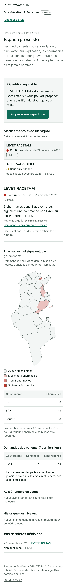
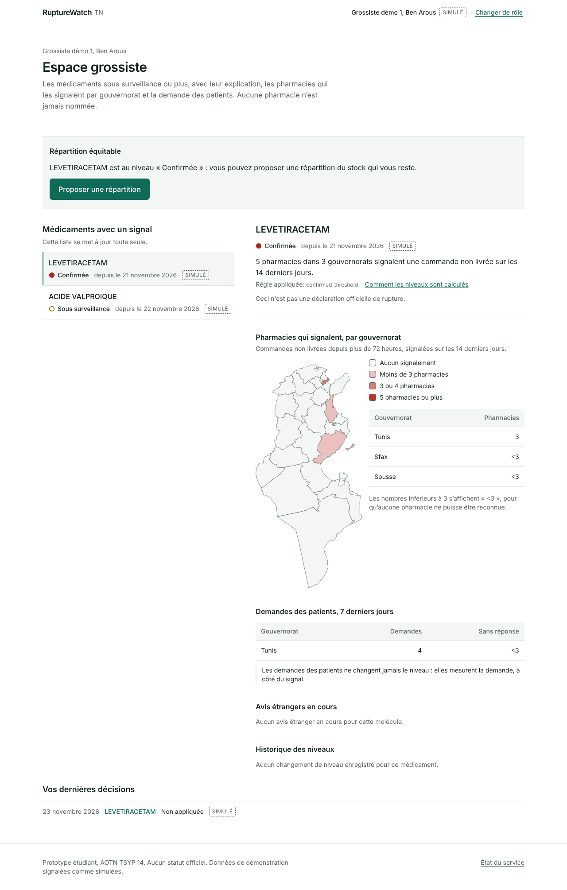
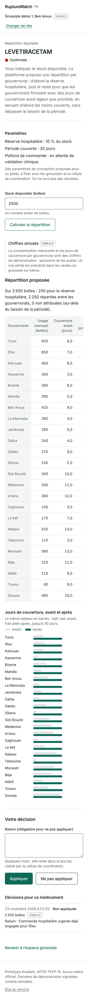
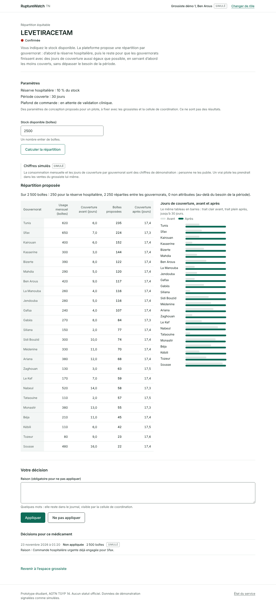
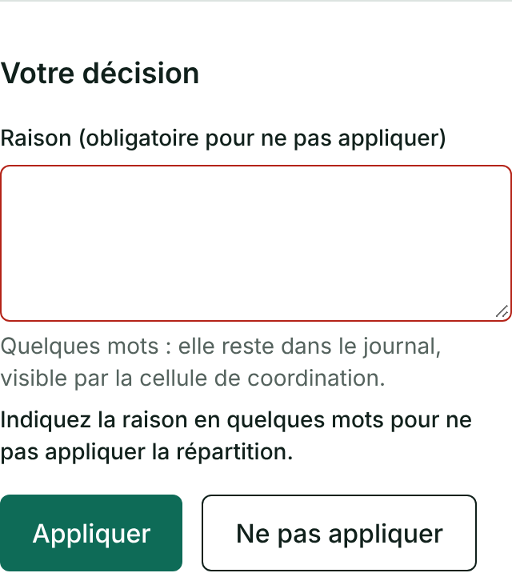

# Track D report: the wholesaler space, and end-to-end tests

Status: **built and tested in the build environment; not yet checked on a Vercel preview.** `npm run check` passes (lint, type check, 412 tests in 32 files). The build environment has no Supabase project, so the screens were checked with a mocked session and mocked signal (section 6); the access rules were checked on the real migrations in PGlite.

## 1. Done checks

| # | Check | Result | How it was checked |
| --- | --- | --- | --- |
| 1 | `lib/allocation` tests pass, including the five listed | **Pass** | `tests/allocation.test.ts`, 10 tests: equal needs give equal shares; a well-covered governorate gets nothing until the others catch up (and then shares); stock above total need is capped, the rest unallocated; zero stock gives zero; totals always add up (stocks 0 to 1,000,000, with the reserve). Also: the reserve comes first, no use means no boxes, nonsense input gives no boxes, rounding never leaves an unserved governorate below a served one by more than one box. |
| 2 | As "Grossiste", a confirmed simulated shortage shows the split for a typed stock, with before/after days of cover and the "Simulé" badge | **Pass locally, mocked signal** | Production build at 360 and 1280 px, with the session and the signal mocked in a scratch copy (no database here). 2,500 boxes: 250 to the hospital reserve, 2,250 to the governorates, every governorate brought to about 17.4 days. Table and bars, "Simulé" badge, parameters and "Plafond de commande : en attente de validation clinique." Screenshots d01, d02. **To check on the preview** once the team lead has a confirmed simulated shortage (`demo:shortage` does not exist yet: the scenario button writes nothing, so a shortage has to be reported with the demo pharmacies, or seeded). |
| 3 | "Ne pas appliquer" without a reason is refused; with a reason it is saved and appears in the coordinator's log | **Partly** | Without a reason: refused in the form (screenshot d03), in the server action, and by the database constraint (`tests/db/allocation-decisions.test.ts`). With a reason: the insert and the coordinator's read are tested on the real migration. The coordinator's log line is track A's (section 4). |
| 4 | No pharmacy name anywhere in the wholesaler space | **Pass** | The wholesaler reads only counts by governorate (database functions) and its own decisions. Rendered pages checked for "Pharmacie démo": none. The access tests show a pharmacy, a hospital pharmacy and another wholesaler read no decision of this wholesaler. |
| 5 | End-to-end tests 1 to 3 pass against the preview | **Test 3 passes locally; 1 and 2 not run** | Test 3 ran against a local production build: the scenario reached "Levée" in 22 s. Tests 1 and 2 need the real database: run `E2E_BASE_URL=<preview> npm run test:e2e` (tests/e2e/README.md). |

## 2. What was built

- **`/grossiste`**: the coordination list, map, demand and explanation, read through the wholesaler's own access rules, "sous surveillance" and above. A band offers "Proposer une répartition" for a molecule at "probable" or "confirmée". The wholesaler's last decisions at the bottom.
- **`/grossiste/repartition/[moleculeId]`**: parameters, the stock field, the simulated-figures notice with its badge, the split as a table and as before/after bars, then "Appliquer" / "Ne pas appliquer" with the reason, and the decisions for this molecule.
- **`lib/allocation/`**: `split.ts` (pure), `params.ts` (design parameters), `decisions.ts` (simulated figures, stored form, reads).
- **Migration** `supabase/migrations/20261123003000_track_d_allocation_decisions.sql`: `allocation_decisions` with row-level security. **Not applied**: the team lead applies it.
- **End-to-end tests**: `playwright.config.ts`, `tests/e2e/core-flows.spec.ts`, `tests/e2e/README.md` (what each test leaves behind).

## 3. Tests added

- `tests/allocation.test.ts` (10) and `tests/db/allocation-decisions.test.ts` (6): who records and reads decisions, the reason rule, no update or delete, organisation and origin set by the database.
- `tests/db/grants.test.ts`: the new table in the privilege matrix, and its insertable columns.

## 4. For the team lead

1. Apply the migration after merging; set `system_meta.schema_version` (left unchanged to avoid collisions between tracks).
2. **Coordination log (track A):** add the wholesalers' decisions. Read `allocation_decisions` with the coordinator's client (it may read all rows), joined to `molecules (name)`. A coordinator cannot read other organisations' names, so show "Un grossiste" or add a small view if the name is wanted.
3. A confirmed simulated shortage on the preview, for done check 2: report the same molecule from at least four demo pharmacies in two governorates, or add the `demo:shortage` script the brief mentions.
4. Run the end-to-end tests against the preview (`npx playwright install chromium` once), then `npm run verify:clean -- --since <time> --apply`.

## 5. Open questions

1. **The reserve share (10 %) and the period (30 days)** are proposals: confirm them, or give the Phase 2.1 values.
2. **One set of simulated figures for every molecule.** Enough for a demonstration; a pilot would have one per molecule from the wholesaler's sales.

## 6. Screenshots

Local production build, system font. **The signal, the counts and the past decision in these screenshots are mocked** (no database in the build environment); the split itself is computed by the real code from the simulated seed figures.

